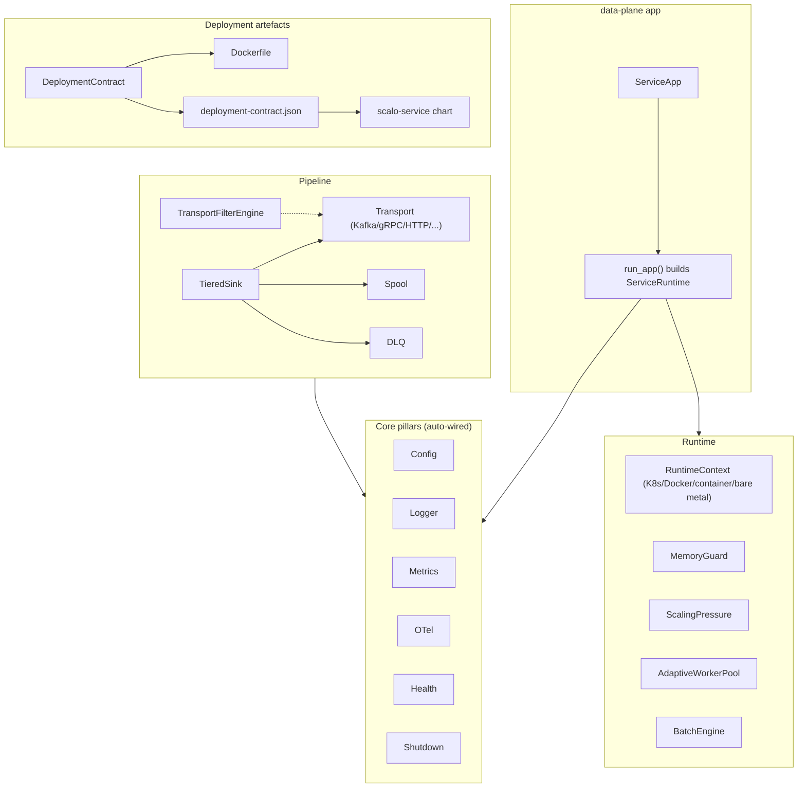

# scalo docs

Shared Rust library for data-plane services. A service built on `run_app` gets the config cascade, structured logs, Prometheus metrics, health probes, OTel traces, graceful shutdown and the K8s pre-stop delay from one call, and the `deployment` feature generates its deployment artefacts. Add a `Transport`, a `TieredSink`, a `BatchEngine` and the same deal extends: counters, span propagation, DLQ routing, backpressure, scaling signals.

This is the index. Read [architecture.md](architecture.md) for the
10,000-foot view of how the modules fit together, [integration.md](integration.md)
for a recipe walkthrough on building a data-plane service, [auto-wiring.md](auto-wiring.md)
for the "you-get-this-for-free" model, and [feature-flags.md](feature-flags.md)
for how features cascade into one another.

---

## What you get for free

| Wire this at startup | And these come along | No need to |
| ---------------------- | ---------------------- | ------------ |
| `config::setup(opts)` | 7-layer cascade, env-var nesting, `.env`, sensitive masking, section registry. Hot reload comes with `config-reload`, the `/config` endpoint with `HttpServer` | Wire figment, write a settings loader, build a reload watcher |
| `logger::setup_default()` | Structured tracing, JSON or text picked from the OTEL endpoint, CI and the terminal, colour only on a terminal, RFC 3339 timestamps, sensitive-field masking, flooding helpers | Install a tracing subscriber, format JSON, pick a logger crate |
| `MetricsManager::new("app")` | Prometheus exporter, `/metrics` endpoint, process metrics, bounded label values, `/metrics/manifest` catalogue | Stand up an exporter, wire a process collector, hand-roll a manifest |
| `run_app(app)` | All of the above + memory guard + scaling pressure + shutdown token + K8s pre-stop delay + runtime context, and the worker pool and batch engine when `worker-pool` or `worker-batch` is on. It builds the `ServiceRuntime` and hands it to `run_service` | Glue them together manually |
| Any `Transport` impl | 3-tier filter engine, DLQ routing, per-direction/action metrics, W3C traceparent propagation | Add filters, wire DLQ, instrument send/recv |
| `TieredSink::new(...)` | Transport + disk-spillover spool + circuit breaker + background drain + backpressure signal (`SpoolFull` for the caller to route, usually to the DLQ) | Compose those primitives by hand |

That's the value proposition. Everything else in these docs is "and here's
how the pieces work".

---

## 10,000-foot view

Solid arrows are runtime data/control flow. Dashed arrows mark embedded
sub-components (filter engine lives inside every transport).

---

## Where to read what

| Area | Page | What it covers |
| --- | --- | --- |
| Start here | [architecture.md](architecture.md) | Module map, dependency graph, layering |
| Start here | [integration.md](integration.md) | "I'm building a data-plane app" walkthrough |
| Start here | [auto-wiring.md](auto-wiring.md) | What's wired into what, and why |
| Start here | [feature-flags.md](feature-flags.md) | Feature tree, native deps, recommended bundles |
| Start here | [crate.md](crate.md) | The crates.io landing page |
| Data plane | [self-regulation.md](self-regulation.md) | ON by default. The three brains (MemoryGuard / ScalingPressure / UnifiedPressure), observe and tune |
| Data plane | [backpressure.md](backpressure.md) | Gate the source, never the sink. The per-stage brake/commit-token table, streaming sub-blocks |
| Data plane | [kafka-path.md](kafka-path.md) | The three batch sizes, sizing profiles and librdkafka names, how the byte budget moves, the partition-limited diagnostic |
| Core pillars | [core-pillars/README.md](core-pillars/README.md) | Section landing |
| Core pillars | [core-pillars/config.md](core-pillars/config.md) | 7-layer cascade, hot-reload, registry, `/config` endpoint |
| Core pillars | [core-pillars/logging.md](core-pillars/logging.md) | tracing setup, JSON/text autodetect, masking, flood control |
| Core pillars | [core-pillars/metrics.md](core-pillars/metrics.md) | Prometheus, the manifest, transport throughput, OTel mode |
| Core pillars | [core-pillars/tracing.md](core-pillars/tracing.md) | OTel, W3C traceparent, transport propagation |
| Core pillars | [core-pillars/health.md](core-pillars/health.md) | `HealthRegistry`, `/livez` / `/readyz` |
| Core pillars | [core-pillars/shutdown.md](core-pillars/shutdown.md) | `CancellationToken`, K8s pre-stop delay |
| Core pillars | [core-pillars/lifecycle.md](core-pillars/lifecycle.md) | Idle until configured, `WorkState`, `pipeline_idle` |
| Runtime | [runtime/README.md](runtime/README.md) | Section landing |
| Runtime | [runtime/service-runtime.md](runtime/service-runtime.md) | `ServiceRuntime`, `ServiceApp` trait, `run_app` |
| Runtime | [runtime/runtime-context.md](runtime/runtime-context.md) | Kubernetes, Docker, container and bare-metal detection, pod metadata |
| Runtime | [runtime/memory.md](runtime/memory.md) | `MemoryGuard`, cgroup-aware backpressure |
| Transport | [transport/README.md](transport/README.md) | Trait architecture, factory, `AnySender`, commit tokens |
| Transport | [transport/backends.md](transport/backends.md) | Kafka, gRPC, Memory, File, Pipe, HTTP |
| Transport | [transport/filter-engine.md](transport/filter-engine.md) | 3-tier filter (SIMD / compiled CEL / complex CEL) |
| Transport | [transport/routing.md](transport/routing.md) | `RoutedSender`, the named sink set: routes, fan-out |
| Deployment | [deployment/README.md](deployment/README.md) | Section landing |
| Deployment | [deployment/contract.md](deployment/contract.md) | `DeploymentContract` struct, schema versioning |
| Deployment | [deployment/artefacts.md](deployment/artefacts.md) | Generated Dockerfile, container manifest, contract JSON |
| Deployment | [deployment/native-deps.md](deployment/native-deps.md) | `NativeDepsContract`, feature -> APT package map |
| Deployment | [deployment/keda.md](deployment/keda.md) | `KedaContract`, scaler triggers, fallback HPA |
| Deployment | [deployment/conformance.md](deployment/conformance.md) | The at-least-once delivery conformance harness |
| Pipeline | [pipeline/README.md](pipeline/README.md) | Section landing |
| Pipeline | [pipeline/acknowledgements.md](pipeline/acknowledgements.md) | When a source's acknowledgement is released |
| Pipeline | [pipeline/batch-engine.md](pipeline/batch-engine.md) | SIMD parse, pre-route filter, field interning |
| Pipeline | [pipeline/worker-pool.md](pipeline/worker-pool.md) | `AdaptiveWorkerPool`, pressure-based scaling |
| Pipeline | [pipeline/tiered-sink.md](pipeline/tiered-sink.md) | Resilient delivery, disk spillover, circuit breaker |
| Pipeline | [pipeline/sink-stack.md](pipeline/sink-stack.md) | Outbound control stack: timeout / load-shed / concurrency / retry / rate-limit |
| Pipeline | [pipeline/dlq.md](pipeline/dlq.md) | File, Kafka, HTTP backends |
| Pipeline | [pipeline/spool.md](pipeline/spool.md) | Disk-backed async FIFO (yaque) |
| Pipeline | [pipeline/strmatch.md](pipeline/strmatch.md) | 4-tier regex->fast-path matcher (Byte / Literal / LiteralSet / Regex) |
| Pipeline | [pipeline/rules.md](pipeline/rules.md) | Ordered first-match rules that set target fields: native tests or CEL Fast, clamp, hit counters, hot reload |
| Pipeline | [pipeline/scaling.md](pipeline/scaling.md) | `ScalingPressure`, KEDA external scaler signal |
| Other subsystems | [api/README.md](api/README.md) | Section landing |
| Other subsystems | [api/auth.md](api/auth.md) | Credential acquisition and placement |
| Other subsystems | [api/secrets.md](api/secrets.md) | OpenBao/Vault, AWS Secrets Manager |
| Other subsystems | [api/http-server.md](api/http-server.md) | axum server, probe wiring, route extensions |
| Other subsystems | [api/http-client.md](api/http-client.md) | `reqwest` + retry + request signing |
| Other subsystems | [api/directory-config.md](api/directory-config.md) | YAML directory store with optional `git2` |
| Other subsystems | [api/concurrency.md](api/concurrency.md) | `BackgroundSink`, `PeriodicWorker`, `ActorHandle` |
| Other subsystems | [api/geoip-download.md](api/geoip-download.md) | GeoIP database provisioning |
| Other subsystems | [version-check.md](version-check.md) | Opt-out startup version check |
| Reference | [reflectable-config-shape.md](reflectable-config-shape.md) | The schema and capability catalogue scalo and scalo-py both emit |
| Reference | [migrations.md](migrations.md) | API and behaviour changes by scalo version |
| Reference | [migrating.md](migrating.md) | Moving from hyperi-rustlib to scalo |
| Reference | [dependency-duplication.md](dependency-duplication.md) | Duplicate crate versions in the dependency tree |
| Reference | [dts-rust-memory-tier-list.md](dts-rust-memory-tier-list.md) | Rust memory structures, tier list |
| Reference | [vector-baselining.md](vector-baselining.md) | The `baseline` benches |

---

## Project facts

- Crate: [scalo](https://crates.io/crates/scalo) on crates.io. Edition, MSRV and the sibling lib are in [architecture.md](architecture.md#project-facts).
- Used by several downstream data-plane services: Kafka-to-ClickHouse loaders, push and pull ingress, long-term archivers, VRL, Vector and Elastic transform apps.
