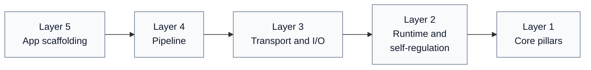

# Architecture

The crate is organised in five layers. Code in a higher layer can depend on
lower layers but never the other way round. Most modules are feature-gated,
so a consumer pays for what it wires in.

Each layer builds on the layers to its right, with two exceptions in layer 1: `shutdown` reads the runtime context and `metrics` holds the memory guard and scaling pressure handles.

*Figure 1. L4 Detail -- Module layers. An arrow points at the layer a layer builds on, and every layer may use any layer to its right.* Up: [L3 Components -- scalo](README.md).

Two modules sit inside another rather than calling it: `transport::filter` lives inside every transport backend, and `sink-stack` wraps a transport sender.

---

## Module map

### L1 - Core pillars (wired by run_app)

| Module | Feature | Purpose |
| -------- | --------- | --------- |
| `config` | `config` (default) | 7-layer cascade (CLI -> env -> .env -> YAML -> defaults), section registry, hot reload with `config-reload`, the `/config` endpoint on `HttpServer` |
| `logger` | `logger` (default) | `tracing-subscriber` with JSON/text autodetect, RFC 3339 timestamps, sensitive-field masking, flood-control helpers |
| `metrics` | `metrics` or `otel-metrics` (`metrics-core` and `metrics-process` are the parts they pull in) | Lock-free counters/gauges/histograms, Prometheus exporter, `/metrics` + `/metrics/manifest`, OTLP metrics push |
| `otel_tracing` | `otel`, `otel-tracing`, and `metrics`, which pulls `otel-metrics` and `otel-tracing` | OTLP exporter, OTel SDK bridge for `tracing` spans |
| `health` | `health` | `HealthRegistry`, which `/readyz` consults |
| `shutdown` | `shutdown` | `CancellationToken`, SIGTERM/SIGINT, K8s pre-stop delay |

Pillars are singletons. Modules in higher layers call into them via macros
(`tracing::info!`, `metrics::counter!`) or global getters
(`config::get`). No handle passing.

### L2 - Runtime and self-regulation

| Module | Feature | Purpose |
| -------- | --------- | --------- |
| `env` | always | Detect environment (Kubernetes, Docker, container, bare metal), `RuntimeContext` singleton (pod, namespace, node, container id, memory limit, CPU quota) |
| `runtime` | `runtime` | XDG/container-aware paths (`RuntimePaths`) |
| `memory` | `memory` | `MemoryGuard` - cgroup-aware OOM prevention with auto-detected limits |
| `scaling` | `scaling` | `ScalingPressure` - KEDA external-scaler signal (0.0-100.0) |
| `governor` | `governor` | `UnifiedPressure` self-regulation gate - latches a hard memory signal with weighted soft signals under hysteresis, driving inbound backpressure |
| `concurrency` | `concurrency` | `BackgroundSink`, `PeriodicWorker`, `ActorHandle` - fire-and-forget, timer, command-queue primitives |
| `strmatch` | `strmatch` | 4-tier string matcher: `Byte`, `Literal`, `LiteralSet`, `Regex` |
| `expression` | `expression` | CEL evaluator (used by transport filters) |

### L3 - Transport and I/O

| Module | Feature | Purpose |
| -------- | --------- | --------- |
| `transport` | `transport`, `transport-{kafka,grpc,memory,file,pipe,http}` | Trait architecture (`TransportBase`, `TransportSender`, `TransportReceiver`, `Transport`), `AnySender` enum dispatch, factory |
| `transport::filter` | `transport` (the two CEL tiers need `expression`) | 3-tier engine (SIMD field ops / compiled CEL / complex CEL) embedded in every backend |
| `http_server` | `http-server` | axum-based server serving `/livez`, `/readyz`, `/health/detailed` and `/config`. `/metrics` and `/metrics/manifest` are on the `MetricsManager` listener |
| `compression` | always (types), `compression` and `compression-snappy` (engines) | `Codec`, `Compression` and `Accepts`, the one `compression` key every surface reads, and the zstd, LZ4, gzip and snappy engines ([compression.md](compression.md)) |
| `http_client` | `http` | `reqwest`, retried by `backon` on the `scalo::backoff` schedule |
| `secrets` | `secrets`, `secrets-vault`, `secrets-aws` | `SecretsManager` over the `SecretProvider` trait, with file, OpenBao/Vault and AWS Secrets Manager providers |
| `directory_config` | `directory-config`, `directory-config-git` | YAML directory store with optional `git2` |
| `output` | `output-file` | NDJSON file output sink |

### L4 - Pipeline

| Module | Feature | Purpose |
| -------- | --------- | --------- |
| `spool` | `spool` | Disk-backed async FIFO queue (`src/yaque`, derived from yaque 0.6.6, + `compression`), with an opt-in per-record CRC32C check (`crc`, off by default) |
| `tiered_sink` | `tiered-sink` | Transport + spool + circuit breaker + background drain |
| `sink_stack` | `sink-stack` | Outbound control stack - composes timeout, load-shed, concurrency-limit, retry/backoff and rate-limit around a transport sender (tower `ServiceBuilder`), and preserves at-least-once |
| `worker::pool` | `worker-pool` | `AdaptiveWorkerPool` (rayon + tokio), pressure-based scaling |
| `worker::engine` | `worker-batch` | `BatchEngine` - SIMD parse (`sonic-rs`), pre-route filter, field interning |
| `dlq` | `dlq`, `dlq-kafka`, `dlq-http` | DLQ sink with file always available, Kafka/HTTP backends opt-in |

### L5 - App scaffolding

| Module | Feature | Purpose |
| -------- | --------- | --------- |
| `cli` | `cli` | `clap` types: `CommonArgs`, `StandardCommand`, `VersionInfo`, output helpers |
| `cli` (service items) | `cli-service` | `ServiceApp` trait, `run_app`, `ServiceRuntime` - full data-plane app scaffolding |
| `top` | `top` | TUI metrics dashboard (`ratatui`) |
| `deployment` | `deployment`, `deployment-smoke` | `DeploymentContract`, generators for Dockerfile / runtime stage / Compose fragment / container manifest. The scalo-service chart renders the Kubernetes objects |
| `version_check` | `version-check` | Startup HTTP probe to the version API |

---

## Layering rules

1. Outside test support and the two layer-1 exceptions above, a module never depends upward: `transport` cannot import from `cli`, and `config` cannot import from `worker`. A module compiled without the one above it cannot name it, so the feature graph enforces most of this.
2. Pillars depend on each other only where they must. `metrics` logs through `tracing` and reads its `metrics` section through `cascade::section`, which returns the defaults when `config` is off.
3. L2 modules work standalone. `MemoryGuard`, `ScalingPressure` and `strmatch` run without the L4 pipeline above them.
4. L3 transports always embed the filter engine. With no filters configured it is a no-op: one `has_inbound_filters()` check per receive and one `has_outbound_filters()` check per send.
5. L4 pipeline modules compose L3 transports with L2 runtime concerns. `tiered_sink` is the clearest case: a transport plus a disk spool plus a circuit breaker that reports to the `HealthRegistry`.
6. L5 scaffolding glues the whole stack. `run_app` builds the `ServiceRuntime`, which wires the pillars, runtime, pipeline primitives and shutdown into the one object `run_service` receives. `DeploymentContract` does the same for shipping: from one struct the generators write the Dockerfile, runtime stage, Compose fragment and container manifest, and `to_json` writes the contract the scalo-service chart renders from.

---

## Feature defaults

- `default = ["config", "logger"]`. Nothing else. Apps explicitly opt in.
- Trimmed defaults keep the "I-just-want-config" use case off the full
  transitive dependency set.
- See [feature-flags.md](feature-flags.md) for the full tree and which
  features pull in which.

---

## Where the dependency graph gets non-obvious

A handful of dependencies aren't visible from layer naming alone:

- `worker-batch` depends on `worker-pool` (the engine sits on top of the
  pool), which in turn depends on `metrics` and `config`.
- `tiered-sink` does not enable `spool`. It runs a separate queue from `src/yaque` through the crate-private `spool_codec` it shares with `spool`, plus an L3 transport.
- `dlq` needs `concurrency` (L2) for the `BackgroundSink` actor that
  drains queued entries.
- `transport-trace` is the *only* transport feature that pulls in OpenTelemetry, and it takes the `opentelemetry` API crate, not the SDK. Apps that send/receive without distributed tracing avoid that dep entirely.
- `cli-service` (L5) reaches across the whole stack - it pulls `cli + health + metrics + memory + scaling + shutdown + governor + lifecycle` because the `ServiceRuntime` that `run_app` builds wires all of them. It pulls no transport, and neither `sink-stack` nor `worker-pool`: an app that moves data or runs a pool declares what it uses.

Read [feature-flags.md](feature-flags.md) for the full feature-to-feature
edges and [auto-wiring.md](auto-wiring.md) for which dependencies are
auto-wired vs explicit.

---

## Project facts

- Edition 2024, MSRV as `rust-version` in `Cargo.toml`.
- Sibling lib: `scalo-py`, the Python control-plane equivalent.
- Downstream: the DFE Rust services consume `scalo` in lockstep. dfe-infra's `suite.yaml` lists them.
