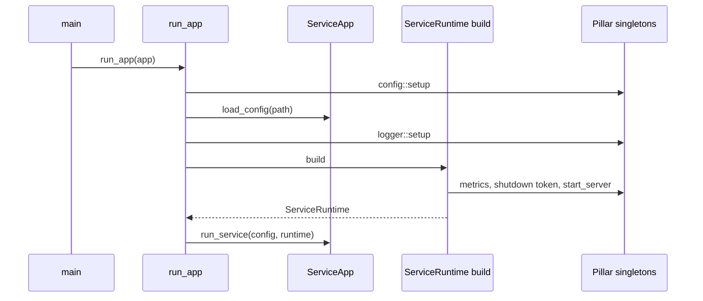
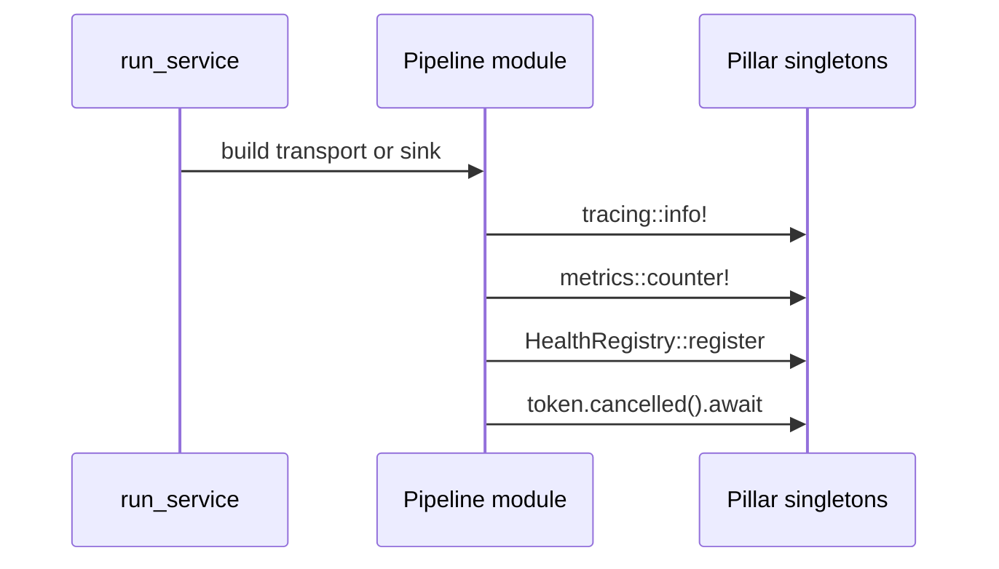

# Auto-wiring

The rule across the crate: **modules talk to each other through global
singletons, not handle passing**. Wire the singleton once at startup,
every module that needs it picks it up via a macro or a global getter.

---

## The singletons

| Pillar | Singleton mechanism | Initialiser | Reader |
| -------- | --------------------- | ------------- | -------- |
| Config | `OnceLock<Config>` | `config::setup(opts)` | `config::get`, `T::from_cascade()`, `Config::unmarshal_key_registered` |
| Logger | Global `tracing` subscriber | `logger::setup_default()` | `tracing::info!`, `warn!`, `error!`, `debug!`, `trace!` macros |
| Metrics | Global `metrics` recorder | `MetricsManager::new("app")` | `metrics::counter!`, `gauge!`, `histogram!` macros |
| OTel | Global meter + tracer provider | `MetricsManager` sets the meter provider (`otel-metrics`), and `logger::setup` adds the span layer (`otel-tracing`) | Propagated through `tracing::span!` and `#[instrument]` |
| Health | `OnceLock<HealthRegistry>`, created on first use | `HealthRegistry::register("module", ...)` | `/readyz` aggregates, `HealthRegistry::is_ready()`, `is_healthy()` |
| Shutdown | `CancellationToken` (from `tokio-util`) | `shutdown::install_signal_handler()`, which `ServiceRuntime::build` calls | `token.cancelled().await` in any task, `shutdown::token()` |
| Runtime context | `OnceLock<RuntimeContext>` | `RuntimeContext::detect()`, run once on first read | `env::runtime_context()` |

These are the pillar singletons. The other process-wide state is the
memory guard's `set_heap_source` hook and the expression evaluator's cached
profile. Everything else passes handles or
borrows.

---

## The flow

`run_app` sets up the cascade and the logger, then builds the `ServiceRuntime`, which starts the metrics listener before `run_service` gets the runtime.

*Figure 1. L4 Detail -- Service startup wiring. Solid arrows are calls, the dashed arrow is the return.* Up: [L3 Components -- scalo](README.md).

With the `lifecycle` feature, `run_app` asks `work_state` before the hand-over and parks a workless config ([core-pillars/lifecycle.md](core-pillars/lifecycle.md)).

A module the app builds in `run_service` reaches each pillar through a macro or a global getter, never a handle.

*Figure 2. L4 Detail -- Module use of the singletons. No handle passes from the app to the module.* Up: [L3 Components -- scalo](README.md).

The app never passes a `Logger` or `MetricsManager` into a module, so a `Transport` impl emits its metrics in any app that has a `MetricsManager` installed.

---

## What's auto-wired versus explicit

`ServiceRuntime::build`, which `run_app` calls, is the one-stop wire-up. It pulls in:

| Singleton | Action |
| ----------- | -------- |
| Logger | Already installed by `run_app` before `ServiceRuntime::build` runs |
| Config | Already loaded by `app.load_config` before `ServiceRuntime::build` runs |
| Metrics | `MetricsManager::with_config(...)` built from the `metrics` config section, bare names unless `metrics.namespace` sets a prefix, with the scalo runtime metric set described |
| Health | Not touched: `HealthRegistry` is created on first use, and modules `register` themselves |
| Shutdown | `CancellationToken` created, SIGTERM/SIGINT handlers attached, K8s pre-stop delay configured |
| Runtime context | `env::runtime_context()` detects once, results cached |
| Memory guard | `MemoryGuard` constructed if `memory` feature on |
| Scaling pressure | `ScalingPressure` built if `scaling` feature on, with `app.scaling_components(config)`. With `service-metrics` on, the served value is written to the `scaling_pressure` gauge once a second |
| Worker pool | `AdaptiveWorkerPool` constructed if `worker-pool` feature on |
| Metrics server | Started on `--metrics-addr` (default `0.0.0.0:9090`) if `metrics` feature on, serving `/metrics` `/metrics/manifest` `/livez` `/readyz` `/scaling/pressure` -- and nothing else |
| Idle gate | `app.work_state(config)` evaluated after the runtime is up if `lifecycle` feature on. A workless config parks instead of entering `run_service` ([core-pillars/lifecycle.md](core-pillars/lifecycle.md)) |

What's **not** auto-wired and needs an explicit call from the app:

- `HttpServer` -- despite the name, `ServiceRuntime` does NOT start it. It is an
  optional extra listener for apps that want one (default `0.0.0.0:8080`), and
  it does not serve `/metrics`. The observability port is the
  metrics server above. See [api/http-server.md](api/http-server.md).

- `TieredSink::new(...)` -- you choose which transport and which spool path, and where its errors go
- `BatchEngine::process_*` -- you choose the parsing strategy and the transform closure
- `AnySender::from_config(...)` / `AnyReceiver::from_config(...)` -- you name the config section (`transport.output`, `transport.input`)
- Anything in `directory-config`, `secrets`, `auth` or `geoip-download` -- these are tools you reach for when needed

Rule of thumb: the **pillars** auto-wire. The **L4 pipeline** modules
are tools you compose into your `run_service`. [README.md](README.md#what-you-get-for-free) lists what each call brings with it.

---

## Why singletons

The alternative is constructor injection -- pass a `Logger` to every
module that logs, a `MetricsManager` to every module that emits
counters, a `Config` to every module that reads config. That model
works in small services. It rots in a crate this size that ships into
several downstream apps, because:

1. Every added module forces a signature change somewhere up the call
   stack to thread the handle through.
2. Library code can't emit metrics without the consumer wiring it
   through. A `Transport` impl that wants to emit `transport_sent_total`
   needs the consumer to thread a `MetricsManager` through to it.
3. Tests duplicate the wiring. Every integration test stands up
   the same handles.
4. It blocks orthogonal features. A module that wants to call
   `tracing::info!` needs a logger handle. With the singleton it's
   automatic.

The singleton model has one failure mode: tests that run in
parallel race on installing the global. The two mitigations:

- Test-only constructors: scalo's tests use the crate-private
  `MetricsManager::new_for_test`, which skips `set_global_recorder`. The
  macros become no-ops, and registry tracking, descriptors and namespace
  logic still run.
- Process-per-test runners: `cargo nextest` runs each test in its
  process of its own. The global is fresh per test.

See [core-pillars/metrics.md Section Testing](core-pillars/metrics.md#testing)
for the test pattern.

---

## What this looks like for a module author

When you add a module to `scalo` (or to a downstream app
that has one), the auto-wiring contract is:

1. A module with configurable behaviour loads via the cascade --
   `T::from_cascade()` or `Config::unmarshal_key_registered::<T>(...)`.
   Don't read env vars directly.
2. A module that does I/O or processing adds `#[cfg(feature = "metrics")]`
   counters/gauges/histograms via the macros, the gate scalo's emitters use. No handle passing.
3. A module that can fail or has interesting state adds
   `tracing::` log calls at the right level. No handle passing.
4. A module that affects service readiness registers into the
   `HealthRegistry`. Aggregated automatically into `/readyz`.
5. A long-lived module takes a `CancellationToken` argument
   (or grabs it off the runtime) and selects on it in its main loop.

Follow that contract and your module ships with full observability the moment the consumer wires `MetricsManager::new` + `logger::setup_default` + `config::setup`. No extra plumbing.
