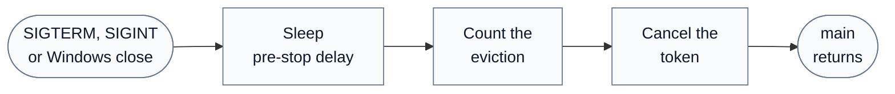

# Shutdown

`shutdown::install_signal_handler()` is called once at startup and returns a
`tokio_util::sync::CancellationToken` that every long-running task clones and
awaits via `token.cancelled().await`. On SIGTERM/SIGINT, or on Windows Ctrl+C, a
console close or a system shutdown, the handler sleeps for a
K8s pre-stop delay, then cancels the token. A Windows service calls `shutdown::trigger()` on its own stop control ([../platforms.md](../platforms.md)). All tasks unblock together, drain
in-flight work and exit. The process exits when `main` returns.

The pre-stop delay keeps traffic off a pod that has stopped accepting work.
Kubernetes takes a terminating pod out of Service endpoints, and kube-proxy
picks that up some seconds later. Without the delay the pod drains while traffic
still arrives. With it, the app keeps serving through that window, and only then
does cancellation reach the tasks. Nothing in the shutdown path changes `/readyz` --
see [health.md](health.md).

`ServiceRuntime` from `cli` calls `install_signal_handler` and hands the token to
`run_service`. Consumer services don't construct the token -- they receive it and `select!`
on `token.cancelled()` in every loop.

---

## Pre-stop delay

| Detection | Default | Override |
| --- | --- | --- |
| K8s (via [`env::runtime_context().is_kubernetes()`](../../src/env.rs)) | 5 seconds | `PRESTOP_DELAY_SECS` |
| Docker / bare metal | 0 (immediate cancel) | `PRESTOP_DELAY_SECS` |

Tune `PRESTOP_DELAY_SECS` via a K8s `Deployment` env entry to match the cluster's
kube-proxy endpoint-sync latency. 5 seconds is the safe default.

The handler sleeps the pre-stop delay before it cancels the token, so the pod serves through the endpoint-removal window and drains after it.



*Figure 1. L4 Detail -- Shutdown sequence. The sleep runs only for a delay above 0, and the count only on Kubernetes with metrics on.* Up: [Core pillars](README.md).

The shutdown module does signal + delay + cancel and nothing else. Nothing in
the shutdown path touches readiness, so `/readyz` answers from the readiness
callback and the health registry throughout. The one flag that does clear is
`HttpServer`'s, when the cancelled token stops it -- see [health.md](health.md).
An app that wants `/readyz` to fail while it drains wires that itself.

In K8s, once the pre-stop delay has run, the handler increments
`pod_eviction_received_total` (if `metrics` or `otel-metrics` is on), for
SIGTERM and SIGINT alike, so eviction events are observable.

---

## Module pattern

Every long-running loop should `select!` on `token.cancelled()` as its first arm:

```rust
use scalo::shutdown;
use tokio_util::sync::CancellationToken;

async fn consumer_loop(token: CancellationToken, mut rx: kafka::Consumer) {
    loop {
        tokio::select! {
            biased;                              // shutdown wins ties
            () = token.cancelled() => {
                tracing::info!("draining consumer");
                rx.drain().await;
                break;
            }
            msg = rx.recv() => { if let Some(m) = msg { process(m).await; } }
        }
    }
}
```

`biased` checks shutdown first on every poll -- without it a saturated channel can
starve the cancellation branch.

For scoped cancellation (cancel a sub-task without shutting down the service), use
`token.child_token()`. Cancelling the parent cancels every child, and cancelling a
child leaves the parent running.

---

## Cancel-safety in `select!`

A future polled by `select!` and dropped when another arm wins must be safe to
drop at any await point. Most tokio primitives are, and a few are not.

| Future | Cancel-safe? | Notes |
| --- | --- | --- |
| `mpsc::Receiver::recv` | Yes | Drop abandons the wait |
| `oneshot::Receiver` | Yes | |
| `time::sleep` | Yes | |
| `TcpListener::accept` | Yes | |
| `CancellationToken::cancelled` | Yes | |
| `broadcast::Receiver::recv` | Yes | No message is received if another arm wins |
| `mpsc::Sender::send` | **Partly** | The message is not sent, and it is dropped with the future -- `reserve()` first and send on the permit to keep it |
| Any state machine you wrote yourself | Usually no | Default to "no" until proven otherwise |

Each tokio method states its cancel safety in its own docs under "Cancel safety".

---

## API surface

| Item | Purpose |
| --- | --- |
| `shutdown::install_signal_handler() -> CancellationToken` | Installs the SIGTERM/SIGINT handler (Ctrl+C, console close and system shutdown on Windows), spawns the wait task and returns the global token |
| `shutdown::token() -> CancellationToken` | Clone the global token (created lazily if no handler installed) |
| `shutdown::trigger()` | Cancel the global token, idempotent: for tests, integration drivers or an internal watchdog |
| `shutdown::is_shutdown() -> bool` | Check cancellation state without awaiting |
| `CancellationToken::cancelled().await` | The await point every module loop uses |
| `CancellationToken::child_token()` | Scoped cancellation not affecting the parent |

| Var | Effect |
| --- | --- |
| `PRESTOP_DELAY_SECS` | Override pre-stop delay (default 5 in K8s, 0 elsewhere) |

---

## Testing

The global token is process-wide. Tests verifying shutdown behaviour construct a
fresh `CancellationToken::new()` and drive it locally rather than touching the
global -- see `trigger_cancels_token` and
`cancelled_future_resolves_after_cancel` in [`src/shutdown.rs`](../../src/shutdown.rs).

`install_signal_handler` spawns a tokio task. A second call returns the same
token but starts a second listener, which waits the pre-stop delay, counts the
eviction and logs again, so call it once at the top of `main`.

---

## Related

- [health.md](health.md) -- what `/readyz` answers, which shutdown leaves alone
- [metrics.md](metrics.md) -- `pod_eviction_received_total` on SIGTERM in K8s
- [../runtime/service-runtime.md](../runtime/service-runtime.md) -- `ServiceRuntime` calls `install_signal_handler`
- [../auto-wiring.md](../auto-wiring.md), [../feature-flags.md](../feature-flags.md)
- Source: [`src/shutdown.rs`](../../src/shutdown.rs)
