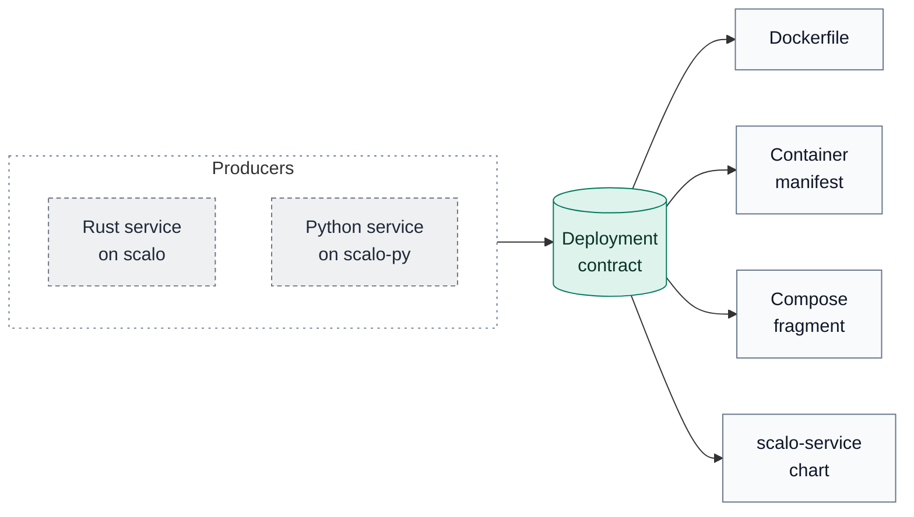

# Contract

`DeploymentContract` is the one struct each service fills in.
From it, scalo derives the Dockerfile, runtime-stage fragment, Compose
fragment and container manifest, and the
[scalo-service](../../charts/scalo-service/README.md) library chart renders
the Kubernetes objects from its JSON -- with no YAML templates in the app.

Fill in the 20% that's app-specific, get the 80% boilerplate for free.
`validate_dockerfile` catches contract-vs-Dockerfile drift in CI.

---

## Why a contract

Hand-maintained Dockerfiles and Helm charts rot: ports added to the
binary but never the chart, healthcheck paths change, new secrets land
in code while the `Secret` template references old key names. The
contract makes the binary the source of truth -- the app declares its
surface, generation produces matching artefacts, validation guards the
boundary.

---

## Schema versioning

`DeploymentContract::schema_version` is the handshake between whatever writes a
contract and whatever reads it. Current version is **4**,
`CONTRACT_SCHEMA_VERSION`, and the field defaults to it. A reader rejects a
version it does not support: the [scalo-service](../../charts/scalo-service/README.md)
library chart renders version 4 only.

| Version | Notes |
| --------- | ------- |
| 1 | Initial shape -- no `image_profile`, no `oci_labels` |
| 2 | `ImageProfile`, `OciLabels`, `SecretGroupContract` |
| 3 | Adds `config_schema` + `capabilities` |
| 4 | Current - adds `writable_paths`, `termination_grace_seconds`, `resources`, `security`, `singleton`, `service_account`, `health.startup_budget_seconds`, `ports[].public`, `ports[].app_protocol`, `secrets[].optional`, `hot_paths`, `memory`, the `x-scalo-dial` keyword in `config_schema`, and `config_mount_path` may be empty |

An app that writes `schema_version: 3` in its struct literal still emits 3, and
a version-4 reader rejects it. Write `CONTRACT_SCHEMA_VERSION` instead. Serde
reads a v3 contract into the v4 types with every new field at its default, and
a v3 reader ignores the v4 fields, because `DeploymentContract` does not set
`deny_unknown_fields`.

### The JSON Schema

`contract_json_schema()` (feature `config-schema`) derives the contract's JSON
Schema, draft 2020-12, from these types with schemars, `schema_version` pinned
and required. It is committed as
`charts/scalo-service/schema/deployment-contract.v4.schema.json`, where a chart
assembler in any language validates a contract against it. A test fails when the
committed file and the derivation differ as JSON values. Key order does not count,
so a schemars release that only reorders properties leaves it passing. Regenerate
with:

```bash
env SCALO_WRITE_CONTRACT_SCHEMA=1 cargo nextest run --all-features -E 'test(committed_contract_schema)'
```

A released version file only widens. `scripts/schema-breaking-check.sh` compares
it with the last release tag in CI and fails on a removed or renamed field, a
narrowed type or enum, a tightened bound or new pattern, a newly required field,
closed properties, a lost `anyOf` branch, or a removed dial. A change that
breaks goes into a `v5` file, beside a `CONTRACT_SCHEMA_VERSION` bump. The
comparison is `breaking_changes(old, new)`, which an app can run on its own
`config_schema` to keep its dials compatible.

---

## Producer tiers

A Rust service on scalo and a Python service on scalo-py write the same contract, and every deployment artefact derives from it.



*Figure 1. L4 Detail -- Contract to chart. The Producers group holds the services that write the contract.* Up: [L3 Components -- scalo](../README.md).

| Producer | Emits |
| ---------- | -------- |
| scalo (this crate) | Rust services, from their config struct |
| scalo-py | Python services, the same contract |

The contract is JSON-serialisable and language-neutral by design, so
cross-language consumers read `deployment-contract.json` (the serialised
form), not this crate.

---

## Struct shape

```rust
use scalo::deployment::*;

let contract = DeploymentContract {
    app_name: "event-loader".into(),
    binary_name: "event-loader".into(),
    description: "Kafka -> ClickHouse data loader".into(),
    env_prefix: "EVENT_LOADER".into(),
    metric_prefix: "loader".into(),
    config_mount_path: "/etc/event-loader/config.yaml".into(),
    image_registry: image_registry_from_cascade()    // org registry -- required
        .unwrap_or_else(|| "registry.example.com/team".into()),
    base_image: base_image_from_cascade(),           // org base image
    entrypoint_args: vec!["--config".into(), "/etc/event-loader/config.yaml".into()],
    secrets: vec![
        SecretGroupContract::new(
            "kafka",
            vec![
                SecretEnvContract {
                    env_var: "EVENT_LOADER__KAFKA__USERNAME".into(),
                    key_name: "username".into(),
                    secret_key: "kafka-username".into(),
                },
                SecretEnvContract {
                    env_var: "EVENT_LOADER__KAFKA__PASSWORD".into(),
                    key_name: "password".into(),
                    secret_key: "kafka-password".into(),
                },
            ],
        ),
    ],
    depends_on: vec!["kafka".into(), "clickhouse".into()],
    keda: Some(KedaContract::default()),
    native_deps: NativeDepsContract::for_scalo_features(
        &["transport-kafka", "spool", "tiered-sink"],
        &base_image_from_cascade(),
    ),
    config_schema: Some(config_schema_json::<Config>()),
    capabilities: vec![
        Capability::transport("kafka")
            .description("Kafka source and sink")
            .maturity("stable"),
    ],
    writable_paths: vec![
        WritablePath::new("spool", "/var/lib/event-loader/spool").size_limit("2Gi"),
    ],
    hot_paths: vec!["routing.rules".into()],
    ..DeploymentContract::default()
};
```

Name what the app sets and end with `..DeploymentContract::default()`. Every
other field takes the default in the table below, so a field a later scalo
release adds does not break the build. `DeploymentContract::default()` alone
leaves `app_name`, `env_prefix`, `metric_prefix` and `image_registry` empty,
and `validate()` rejects it until they are set.

### Fields

| Field | Type | Default | Notes |
| ------- | ------ | --------- | ------- |
| `schema_version` | `u32` | `4` | A reader rejects an unsupported version |
| `app_name` | `String` | required | Matches `Chart.yaml` `name`. Image repo segment |
| `binary_name` | `String` | `""` | Falls back to `app_name` via `.binary()` |
| `description` | `String` | `""` | Chart description |
| `metrics_port` | `u16` | `9090` (`DEFAULT_METRICS_PORT`) | Metrics + health listen port |
| `health` | `HealthContract` | default | Probe paths -- see below |
| `env_prefix` | `String` | required | Config env prefix, with `__` as the nesting separator |
| `metric_prefix` | `String` | required | Prometheus namespace |
| `config_mount_path` | `String` | `""` | E.g. `/etc/event-loader/config.yaml`. Empty means the app reads no config file (v4) |
| `image_registry` | `String` | required | Container registry base, and `validate()` rejects an empty one |
| `extra_ports` | `Vec<PortContract>` | `[]` | HTTP / gRPC / data ports beyond metrics -- see [Ports](#ports) |
| `unbound_listen_paths` | `Vec<String>` | `[]` | `default_config` listen paths no port serves -- see [Ports](#ports) |
| `entrypoint_args` | `Vec<String>` | `[]` | Default `CMD` args, and the compose fragment's `command`. Both follow the image's `ENTRYPOINT [binary]`, so neither names the binary |
| `secrets` | `Vec<SecretGroupContract>` | `[]` | K8s secret groups |
| `default_config` | `Option<Value>` | `None` | Embedded `values.yaml` `config:` block |
| `depends_on` | `Vec<String>` | `[]` | Compose-only service deps |
| `keda` | `Option<KedaContract>` | `None` | See [keda.md](keda.md) |
| `base_image` | `String` | cascade | Runtime base for the Dockerfile |
| `native_deps` | `NativeDepsContract` | default | See [native-deps.md](native-deps.md) |
| `image_profile` | `ImageProfile` | `Production` | See below |
| `oci_labels` | `OciLabels` | default | Static OCI labels and the namespace of scalo's keys -- see [Labels](#labels) |
| `config_schema` | `Option<Value>` | `None` | JSON Schema of the app's `Config` (v3). Dials have `x-scalo-dial` (v4) -- see [Dials](#dials) |
| `capabilities` | `Vec<Capability>` | `[]` | Runtime-surface catalogue (v3) |
| `writable_paths` | `Vec<WritablePath>` | `[]` | Directories the app writes, so the root filesystem stays read-only (v4) -- see [Writable paths](#writable-paths-resources-and-security) |
| `termination_grace_seconds` | `u32` | `45` | Seconds between SIGTERM and SIGKILL (v4) |
| `resources` | `ResourcesContract` | empty | The app's requests and limits. Empty leaves the chart default (v4) |
| `memory` | `Option<MemoryProfile>` | `None` | Memory under the standard load, from `bench-memory` through `generate-artefacts --memory-profile` only. Omitted from the JSON while `None` (v4) -- see [Memory](#memory) |
| `security` | `SecurityContract` | uid/gid/fsGroup 1000, read-only root | Identity and capabilities the image runs with (v4) |
| `singleton` | `bool` | `false` | Exactly one pod: no autoscaling, Recreate rollout (v4) |
| `service_account` | `ServiceAccount` | `Own` | `none` for an app that calls no Kubernetes API: the chart creates no ServiceAccount and the pod names none. Omitted from the JSON while `own` (v4) -- see [Writable paths](#writable-paths-resources-and-security) |
| `hot_paths` | `Vec<String>` | `[]` | Dotted config paths the app reloads while it runs. Omitted from the JSON while empty (v4) -- see [Hot paths](#hot-paths) |
| `openssl_conf` | `String` | `/tmp/scalo-openssl.cnf` | `OPENSSL_CONF` in the image and the pod, the file a Kafka client writes its TLS floor into ([TLS profiles](../tls-profiles.md#fips-and-kafka)). Empty sets none, for an app with no Kafka client that runs another OpenSSL user. Omitted from the JSON at its default (v4) |

`HealthContract` fields:

| Field | Default | Consumed by |
| ------- | --------- | ------------- |
| `liveness_path` | `/livez` | Dockerfile `HEALTHCHECK`, Helm `livenessProbe` AND `startupProbe` |
| `readiness_path` | `/readyz` | Helm `readinessProbe` |
| `metrics_path` | `/metrics` | Prometheus scrape annotation on the pod |
| `startup_budget_seconds` | `150` | How long the scalo-service startup probe waits for the liveness path before a restart. At least 1 (v4) |

Those three paths are the whole probe surface. There are no aliases -- a
retired path returns 404, deliberately, because an alias that keeps answering
200 hides a probe still aimed at the old name.

There is no startup field and no `/startupz`: the `startupProbe` targets
`liveness_path`, since Kubernetes suspends liveness until the startup probe
passes, so one path gives both a generous boot budget and a tight liveness
period without the two drifting apart.

`config_schema` is the JSON Schema (draft 2020-12) of the app's
`Config`, derived by schemars - `None` when the app does not derive
`JsonSchema`. `capabilities` is the hand-authored catalog of runtime-data
surface schemars cannot see (service names and their knobs). Empty when
the app supplies none. Both are written out as
`config-schema.{json,yaml}` and `capability-catalog.{json,yaml}` by
`emit_config_artifacts`.

The field that bites people is `secrets`: it's `Vec<SecretGroupContract>`,
not flat. Each group bundles env vars sharing one K8s `Secret` (one
Secret per backend -- Kafka credentials, ClickHouse password, Vault
token).

| Field | Purpose |
| ------- | --------- |
| `group_name` | The chart's `secrets.<group>` values section. The Secret defaults to `<fullname>-<group>` |
| `env_vars[].env_var` | The full env var name injected into the pod (`EVENT_LOADER__KAFKA__PASSWORD`) |
| `env_vars[].key_name` | The values key `secrets.<group>.keys.<key_name>` that overrides the data key |
| `env_vars[].secret_key` | Default K8s Secret data key (`kafka-password`) |
| `optional` | The app starts without the group, so a missing Secret or key leaves the variable unset (v4). Build with `SecretGroupContract::new(..).optional()` |

---

## Writable paths, resources and security

These v4 fields describe what the container needs from the pod. The
[scalo-service](../../charts/scalo-service/README.md) library chart renders
them.

```rust
writable_paths: vec![
    WritablePath::new("spool", "/var/lib/event-loader/spool")
        .size_limit("2Gi")
        .when(PortCondition::Enabled { path: "config.spool.enabled".into() }),
    WritablePath::new("state", "/var/lib/event-loader/state").persistent("5Gi"),
],
security: SecurityContract {
    capabilities_add: vec!["NET_BIND_SERVICE".into()],
    ..SecurityContract::default()
},
singleton: true,
```

| Type | Field | Default | Notes |
| --- | --- | --- | --- |
| `WritablePath` | `name` | required | 1 to 50 lowercase letters, digits and inner hyphens. A persistent path's claim is `<chart name>-<name>` |
| | `path` | required | Absolute mount path |
| | `size_limit` | `""` | Cap on an ephemeral path, a Kubernetes quantity. Empty is no cap |
| | `persistent` | `false` | A claim that outlives the pod instead of an `emptyDir` |
| | `size` | `"1Gi"` | The claim's requested size |
| | `when` | `None` | A `PortCondition`, read as for ports, and `None` is always |
| `ResourcesContract` | `requests`, `limits` | empty | Each a `ResourceList` of `cpu` and `memory` quantities. Empty is unset |
| `SecurityContract` | `run_as_user`, `run_as_group`, `fs_group` | `1000` | Numeric. Uid 0 lets the process run as root |
| | `read_only_root_filesystem` | `true` | Writes go to `writable_paths` |
| | `capabilities_add` | `[]` | Upper-case Linux capability names, added after every other one is dropped |

A chart always adds a scratch `/tmp` beside the declared paths.

An app with a file DLQ builds its contract with `.with_dlq(&dlq_config)` (feature `dlq`), passing the `DlqConfig` it spawns the DLQ with. That adds a `dlq` path at `file.path` whenever the DLQ writes files, so the file backend starts on the read-only root filesystem. A `kafka_only` DLQ, a DLQ or file backend that is off, or a directory under a declared path adds nothing.

`service_account: ServiceAccount::None` (`"none"` in the JSON) is for an app with no Kubernetes client and no use for a token. The scalo-service chart then creates no ServiceAccount and leaves `serviceAccountName` off the pod, so it runs as the namespace's `default` account with the token still unmounted. Values can still set `serviceAccount.create` either way, or `serviceAccount.name` to run as an account the operator supplies.

---

## Memory

`memory` is what the service held under the standard load, measured on the release binary by `bench-memory` (feature `bench-memory`). Nothing else writes it. `generate-artefacts` takes it only from a profile file and rejects a contract that sets it in code.

```bash
my-app bench-memory --output ci/memory-profile.json
my-app generate-artefacts --output-dir ci/ --memory-profile ci/memory-profile.json
```

`bench-memory` loads the config and builds the runtime as `run` does, then hands `ServiceApp::bench_pipeline` an in-memory source and sink. Producers offer JSON records to the source, a drain discards what reaches the sink, and after the warm-up the figure the memory guard reads by default is sampled at the end of each interval. An app with no `bench_pipeline` exits non-zero and writes nothing.

| Flag | Default | Recorded as |
| --- | --- | --- |
| `--records-per-second` | `5000` | `load.records_per_second`, split evenly across the sources |
| `--record-bytes` | `1024` | `load.record_bytes`, 16 bytes to 16 MiB |
| `--sources` | `1` | `load.sources`, the producers feeding the source at once |
| `--warmup-seconds` | `30` | `warmup_seconds` |
| `--window-seconds` | `120` | `window_seconds` |
| `--sample-interval-ms` | `1000` | `samples`, the window over the interval |
| `--output` | `memory-profile.json` | the file written |

| Field | Notes |
| --- | --- |
| `min_bytes`, `avg_bytes`, `max_bytes` | Lowest, mean and highest sample. `validate()` needs them above 0 and rising in that order |
| `load` | `records_per_second`, `record_bytes` and `sources` the run offered |
| `warmup_seconds`, `window_seconds`, `samples` | How the window was taken |
| `reading` | `cgroup-v2` or `cgroup-v1`, the cgroup working set of every process in it. `proc-status`, this process's `VmRSS`. `working-set` on Windows, `task-info` on macOS |

Run the bench in the app's own image to read `cgroup-v2`, the figure kubelet evicts on. In a CI runner's container the cgroup covers the runner too.

The scalo-service chart does not read `memory`. A chart that does sets `requests.memory` from `avg_bytes` and `limits.memory` from `max_bytes` plus a headroom it chooses, above its library default and below the contract's `resources` and the deployment's `resources` values, so either of those still wins. Helm reads the figures as floats, so they go through `int64` before `toString`, or `104857600` renders as `1.048576e+08`:

```yaml
{{- with $contract.memory }}
{{- $_ := set $resources.requests "memory" (.avg_bytes | int64 | toString) }}
{{- $_ := set $resources.limits "memory" (mulf .max_bytes (addf 1 $.Values.memoryHeadroom) | ceil | int64 | toString) }}
{{- end }}
```

A plain byte count is a Kubernetes memory quantity, so no unit is added.

---

## Hot paths

`hot_paths` names the config sections an app reloads from its mounted config file while it runs, such as a rule set behind a [`ConfigReloader`](../core-pillars/config.md#hot-reload) ([../pipeline/rules.md](../pipeline/rules.md#hot-reload)). The scalo-service chart hashes the config into the pod's `checksum/config` annotation to roll the pods on a change, and leaves these paths out of that hash. An edit under a hot path then reaches the running pods through the ConfigMap the kubelet refreshes, and an edit anywhere else still rolls them.

```rust
hot_paths: vec!["rules".into(), "routing.source_rules".into()],
```

| Rule | Why |
| --- | --- |
| Each path is dotted, each segment letters, digits, `_` or `-` | The chart splits it on `.` to walk the values |
| Unique | Listed once |
| Needs `config_mount_path` | No config file, nothing to reload |

A parent the removal leaves empty is dropped from the hash too, so adding the first entry under a hot path rolls nothing. The ConfigMap itself keeps every key. With `configMount.subPath` the kubelet never refreshes the file, so the chart hashes every path and an edit rolls the pods. `validate()` rejects a path that breaks the rules above.

---

## Dials

A dial is a config setting an operator is expected to tune per deployment. Mark
it in the app's `Config` with the `x-scalo-dial` JSON Schema keyword
(`DIAL_KEYWORD`), set to `big` (most deployments tune it) or `small` (a few do).
Constraints stay plain JSON Schema:

```rust
#[derive(schemars::JsonSchema)]
struct Buffer {
    /// Rows held before a flush.
    #[schemars(extend("x-scalo-dial" = "big"), range(min = 1, max = 10_000_000))]
    flush_rows: u64,
}
```

`dials(config_schema)` returns every marked node by dotted path, with local
`$ref`s inlined. A chart assembler copies exactly those nodes into the chart's
`values.schema.json` under `config`, so an operator gets a typed, bounded value
for each dial and every other config key passes through unvalidated. Narrowing a
dial's constraint or removing a dial is a breaking change: a value an operator
stored fails every later render.

---

## Ports

A port can say when its listener exists, and which listen address it serves.

```rust
extra_ports: vec![
    PortContract::tcp("http", 8080).bound_from("http.listen").public(),
    PortContract::tcp("push", 6000)
        .when_one_of("config.source.transport", ["direct", "grpc"])
        .bound_from("source.grpc.listen")
        .app_protocol("kubernetes.io/h2c"),
    PortContract::udp("netflow", 2055)
        .when_enabled("config.flow.enabled")
        .bound_from("flow.bind_address"),
],
```

`public()` (v4) marks a port clients outside the cluster connect to. The
scalo-service chart puts such ports on a load balancer when the deployment asks
for one. `app_protocol` (v4) is written to the Service port's `appProtocol`, so a
proxy in front of a plain-text gRPC port speaks HTTP/2 to it.

### `when` -- ports that only sometimes listen

A service with two transports binds its push listener on one of them only. Without a gate the port lands in every artefact anyway, so the Service publishes a port that rejects connections.

| Condition | Builder | Holds when the value |
| --- | --- | --- |
| `Enabled { path }` | `.when_enabled(path)` | counts as true -- anything but false, null, zero or empty |
| `Equals { path, value }` | `.when_equals(path, value)` | as a string, equals `value` |
| `OneOf { path, values }` | `.when_one_of(path, values)` | as a string, is one of `values` (for a setting with an alias) |

`path` is a dotted `.Values` path, the same convention as the KEDA trigger's, so app config sits under `config.` -- `config.source.transport`. The scalo-service chart reads it against the config the app ends up running: the contract's `default_config`, then `config`, then `configOverrides`. A missing or null key reads as off, never as a render error, and a `one_of` with no values never holds.

Gate `equals` and `one_of` on a string or boolean setting. Both compare the chart's `toString` of the value, and Helm reads a large number in `values.yaml` as a float, so `1000000` in the config prints as `1e+06` and never matches. A numeric gate compares unreliably.

| Artefact | A gated port |
| --- | --- |
| scalo-service `Deployment` + `Service` | rendered only while the condition holds, so only when the listener is on |
| Dockerfile + runtime stage | left out of `EXPOSE`, listed in a comment right under it with its condition |
| `container-manifest.json` | left out of `expose_ports`, listed under `conditional_ports` (key present only when a port is gated) |
| compose fragment | published when the condition holds for `default_config`. Otherwise a commented-out line to uncomment |
| `unresolved_values_paths()` | reports a gate whose path is absent from `default_config` (null is off, not missing) |

A port without `when` is always on: in every `EXPOSE`, `expose_ports` and published compose port, and in the chart without a condition. A UDP port is written as UDP everywhere -- `514/udp` on `EXPOSE`, in `expose_ports` and on the compose port, since a bare number means TCP -- and the chart writes every protocol upper case (`tcp` renders `TCP`), because Kubernetes takes no other spelling.

### What every port must be

`DeploymentContract::validate()` runs first in every generator and in `generate-artefacts`, which return `InvalidContract` and write nothing when it fails. It needs, for each extra port:

- a name Kubernetes takes -- 1 to 15 lowercase letters, digits and single inner hyphens, with at least one letter (`syslog-udp`, not `Syslog_UDP`)
- a protocol of TCP, UDP or SCTP, in any case
- no control character in a `when` path or value, in `bound_from`, or in `app_protocol`

Beyond the ports, `validate()` needs:

- each writable path to have a unique name of 1 to 50 lowercase letters, digits and inner hyphens, a unique absolute path, and a size when it is persistent
- each hot path to be a unique dotted path beside a config file ([Hot paths](#hot-paths))
- each `security.capabilities_add` entry to be an upper-case capability name such as `NET_ADMIN`
- a `singleton` to leave KEDA off
- every `x-scalo-dial` in `config_schema` to be `big` or `small`, with every `$ref` the dial search follows resolving

The Dockerfile, runtime-stage and compose generators print a gated port's name and condition onto one comment line with any control character escaped, so a newline in a contract value cannot start a Dockerfile instruction or a YAML key. Run `validate()` in a test to catch the contract itself.

### `bound_from` -- listeners that no port declares

The other direction. `bound_from` names the `default_config` listen address a port serves, as a dotted path relative to `default_config` (`grpc.listen`, not `config.grpc.listen`). `DeploymentContract::undeclared_listeners()` walks `default_config` for listen addresses -- a key named `listen`, `bind_address` or ending `_bind_address` holding a string or null, plus `metrics.address` -- and reports:

- a listen address no port claims
- a `host:port` whose port differs from the port claiming it (`metrics.address` is claimed by `metrics_port`). A null or host-only value is not compared
- a `bound_from` that names nothing in `default_config`

Several ports can claim one address -- three UDP flow ports on one host-only `bind_address` is clean. A client that only sends still has a bind address. List it in `unbound_listen_paths` to waive it. Put the check in a test:

```rust
#[test]
fn every_listener_has_a_port() {
    scalo::deployment::assert_listeners_declared(&deployment_contract());
}
```

`generate-artefacts` runs the same check first and writes nothing while it has a finding.

Neither `bound_from` nor `unbound_listen_paths` changes a byte of any generated artefact.

---

## Dev profile derivation

`ImageProfile::Development` is a one-line variant: same binary, same linking, plus diagnostic tools (`bash`, `strace`, `tcpdump`, `procps`, `dnsutils`, `net-tools`, `less`, `jq`).

```rust
let prod = build_contract();
let dev  = prod.with_dev_profile();   // ImageProfile::Development

generate_dockerfile(&prod, None);    // base_image + runtime libs only
generate_dockerfile(&dev, None);     // + strace, tcpdump, ...
```

The profile changes what is in the image, not its tag. The release pipeline tags images `:v<version>`, `:latest` and `:sha-<short>`, so the pull reference is `myapp:v<version>`, with the `v`. It pushes no `-dev` variant: an operator who wants the diagnostic tools in a debug pod builds the dev image from `generate_dockerfile(&dev, None)`.

---

## Labels

scalo stamps a few keys of its own beside the standard `org.opencontainers.image.*` labels. They share one reverse-DNS namespace, `oci_labels.label_namespace`, which defaults to `io.scalo` (`DEFAULT_LABEL_NAMESPACE`):

| Key | Where | Value |
| --- | --- | --- |
| `<namespace>.profile` | Dockerfile, runtime stage, container manifest | `production` or `development` |
| `<namespace>.app` | container manifest | `app_name` |
| `<namespace>.metrics_port` | container manifest | `metrics_port` |
| `<namespace>.contract.version` / `.source-commit` / `.image-ref` | Dockerfile, when a `ContractIdentity` is passed, and `ContractIdentity::as_yaml_annotations` renders the same keys for a chart or `Application` built elsewhere | see `ContractIdentity` |

An app that ships a namespace of its own keeps it by setting `label_namespace`, and every key above moves with it.

`oci_labels.vendor`, `oci_labels.licenses` and `oci_labels.copyright` are empty by default, and an empty one writes nothing: no label and no `# License` or `# Copyright` header line. Set them to name the app's publisher, licence and copyright holder.

---

## Cascade-driven defaults

These read from the config cascade so ops can change them org-wide
without rebuilding each app. Wire them into the contract builder to pull
registry and base image from `settings.yaml` rather than baking them into
source.

| Function | Cascade key | Default |
| ---------- | ------------- | --------- |
| `image_registry_from_cascade()` | `deployment.image_registry` | none -- returns `None`, and the contract must name a registry |
| `base_image_from_cascade()` | `deployment.base_image` | `debian:trixie-slim@sha256:...` (`DEFAULT_BASE_IMAGE`) |
| `resolve_base_distro(base_image)` | `deployment.base_distro` | derived from `base_image` |

There is no default registry: where an organisation pushes its images is not something a library can guess, and a guess sends images to someone else's.

The default base image is pinned to its multi-arch index digest, so every build
of one scalo release gets the same bytes. Renovate moves the digest.

Overriding `base_image`? Keep `glibc(runtime) >= glibc(build host)` and
stay off musl (alpine) -- see [native-deps.md](native-deps.md#glibc-keep-runtime--build).
Pin it by digest too, as anything shipped must be. Keep the tag beside the
digest (`image:tag@sha256:...`) so the release still derives, or set
`base_distro` - runtime package names are release-specific and a digest-only
reference has no codename.

---

## API surface

| Item | Purpose |
| ------ | --------- |
| `DeploymentContract` | Top-level contract struct. `Default` fills every field with its documented default, for the `..DeploymentContract::default()` form |
| `DeploymentContract::validate()` | Refuse a contract the chart would refuse. Every generator runs it first |
| `DeploymentContract::with_dev_profile()` | Clone with `ImageProfile::Development` |
| `DeploymentContract::to_json()` / `to_yaml()` | Serialise for CI consumption |
| `DeploymentContract::binary()` | Effective binary name (falls back to `app_name`) |
| `DeploymentContract::config_filename()` / `config_dir()` | Split `config_mount_path` |
| `ImageProfile::{Production, Development}` | Profile enum |
| `HealthContract` | `/livez` / `/readyz` / `/metrics` paths |
| `PortContract` | Extra container port beyond `metrics_port`. Build with `tcp` / `udp`, gate with `when_*`, link with `bound_from`. A `UDP` protocol (any case) is carried into compose as `"514:514/udp"` and into `EXPOSE` and `expose_ports` as `514/udp`. `validate()` rejects a protocol other than TCP, UDP or SCTP (any case) |
| `PortCondition` | When a port's listener exists -- see [Ports](#ports) |
| `DeploymentContract::undeclared_listeners()` / `assert_listeners_declared()` | Listener coverage -- see [Ports](#ports) |
| `SecretGroupContract` | One K8s Secret's worth of env vars |
| `SecretEnvContract` | Single env var sourced from a Secret key |
| `OciLabels` | Static OCI labels (`title`, `description`, `vendor`, `licenses`, `copyright`) and `label_namespace` |
| `NativeDepsContract` | Runtime APT packages -- see [native-deps.md](native-deps.md) |
| `KedaContract` | Autoscaling thresholds -- see [keda.md](keda.md) |
| `DEFAULT_BASE_IMAGE` / `DEFAULT_LABEL_NAMESPACE` / `DEFAULT_METRICS_PORT` | Defaults used when the cascade or the contract is silent |
| `image_registry_from_cascade()` / `base_image_from_cascade()` | Cascade readers |
| `Capability` / `FieldSpec` | Capability-catalog entry and its config fields |
| `config_schema_json::<T>()` | Derive the JSON Schema for the app's `Config` |
| `CONTRACT_SCHEMA_VERSION` | The contract schema version this crate writes and reads (4) |
| `WritablePath` / `ResourcesContract` / `ResourceList` / `SecurityContract` / `ServiceAccount` | v4 pod needs -- see [Writable paths](#writable-paths-resources-and-security) |
| `MemoryProfile` / `BenchLoad` / `MemoryReading` | The `memory` block, its load and what each sample read -- see [Memory](#memory) |
| `ServiceApp::bench_pipeline` / `cli::BenchPipeline` | The app's pipeline between the bench source and sink (feature `bench-memory`) -- see [Memory](#memory) |
| `contract_json_schema()` / `contract_schema_file_name(version)` | The contract's JSON Schema and its committed file name (feature `config-schema`) |
| `DIAL_KEYWORD` / `DIAL_TIERS` / `dials(config_schema)` | The dial marker, its two values, and every marked node by path -- see [Dials](#dials) |
| `breaking_changes(old, new)` / `SchemaBreak` / `SchemaBreakKind` | Every change between two JSON Schemas that rejects what the old one accepted |

`oci_labels.licenses` and `oci_labels.copyright` name the app's licence and copyright holder. `licenses` sets the `org.opencontainers.image.licenses` label and the generated Dockerfile's `# License` header line, and `copyright` sets its `# Copyright` line. Both are empty by default, and an empty one writes no label and no line, so an app's artefacts carry only the terms the app states.

---

## CI integration

`<app> generate-artefacts --output-dir ci/` (a `cli`-feature
subcommand) emits the contract. A chart assembler turns it into the thin
chart the service ships, and `validate_dockerfile` confirms a committed
Dockerfile still matches the contract.

See [artefacts.md](artefacts.md) for what generation writes and
[../integration.md](../integration.md) for the `ServiceApp::deployment_contract`
hook that exposes the contract to the CLI.

---

## Related

- [artefacts.md](artefacts.md) -- what `generate-artefacts` writes
- [../../charts/scalo-service/README.md](../../charts/scalo-service/README.md) -- the library chart that renders a contract, and the thin-chart format
- [native-deps.md](native-deps.md) -- auto-detected APT packages
- [keda.md](keda.md) -- autoscaling contract
- [../auto-wiring.md](../auto-wiring.md) -- singleton pattern
- [../integration.md](../integration.md) -- `ServiceApp` trait
- [../feature-flags.md](../feature-flags.md) -- `deployment`, `cli`
- Source: [../../src/deployment/contract.rs](../../src/deployment/contract.rs)
