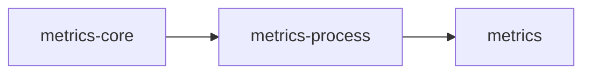
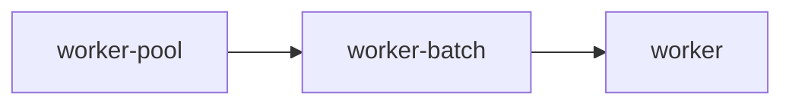
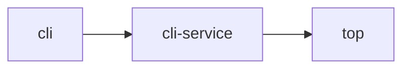

# Feature flags

`scalo` ships ~60 cargo features. The trim in 2.6.0 dropped
defaults to the minimum (`config`, `logger`) so the
"I-just-want-config" use case avoids ~200 transitive deps. Every other
feature is opt-in.

This doc covers:

- The default set and why it's minimal
- The feature tree (which feature pulls in which)
- Native-deps that come with certain features (apt packages on Linux)
- Recommended bundles for common app shapes

For the *what* -- what a feature actually does -- see the subsystem doc
linked in each row. This page is about which features to enable and what
that costs.

---

## Defaults

```toml
[dependencies.scalo]
version = "2"
# default = ["config", "logger"]
```

That's it. The default set covers:

- 7-layer config cascade, with YAML parsed through `scalo::yaml`
- Structured logging via `tracing-subscriber`

If you only need those two, you can stop reading.

---

## Tier-split features (the not-so-obvious ones)

Several features ship in tiers so callers pay only for what they use.

### Metrics



| Feature | Adds |
| --------- | ------ |
| `metrics-core` | scalo's own dependency on the `metrics` crate. No exporter and no `scalo::metrics` API |
| `metrics-process` | Above + `sysinfo`, which the cgroup-aware process gauges (RSS, CPU, FDs) use. Exposes no API on its own: the gauges come with `metrics` or `otel-metrics` |
| `metrics` | Above + Prometheus exporter, `/metrics` HTTP endpoint, manifest dump, OTLP push |

Pick `metrics` for service binaries. scalo's own series, the tiered sink's and the transports' among them, are compiled only when `metrics` is on somewhere in the build. A library that emits its own series depends on the `metrics` crate directly and leaves the exporter to the service. See [core-pillars/metrics.md](core-pillars/metrics.md#feature-tiers).

### Worker pool



| Feature | Adds |
| --------- | ------ |
| `worker-pool` | `AdaptiveWorkerPool` (rayon + tokio) with pressure-based scaling |
| `worker-batch` | Above + `BatchEngine` (SIMD JSON via `sonic-rs`, field interning via `dashmap`) and the `parse_guard` JSON depth pre-check (`wide`) |
| `worker` | Alias for `worker-batch` -- back-compat |

### CLI



| Feature | Adds |
| --------- | ------ |
| `cli` | `clap`-based `CommonArgs`, `StandardCommand`, `VersionInfo`, output helpers |
| `cli-service` | Above + `ServiceApp` trait, `run_app`, `ServiceRuntime` (pulls `metrics + memory + scaling + shutdown + governor + sink-stack + lifecycle`). The worker pool is opt-in: add `worker-pool`, or `worker-batch` for the pool plus `BatchEngine` |
| `lifecycle` | Idle-until-configured gate (`WorkState`, `IdleGate`, `pipeline_idle`) -- folded into `cli-service` |
| `top` | Above + `ratatui` TUI metrics dashboard |

### Transport

| Feature | Adds |
| --------- | ------ |
| `transport` | Base trait architecture, factory, `AnySender`, and the `parse_guard` JSON depth pre-check (`wide`) |
| `transport-trace` | Above + W3C traceparent propagation (pulls `opentelemetry`) |
| `transport-memory` / `-kafka` / `-grpc` / `-file` / `-pipe` / `-http` | Individual backends -- each pulls only its own deps |
| `transport-grpc-vector-compat` | Vector.dev wire-compat for a transform consumer |
| `transport-all` | All six backends |

Pick backends explicitly. `transport-all` is a convenience for tests; in
production apps list only what you actually use.

### DLQ

| Feature | Adds |
| --------- | ------ |
| `dlq` | File backend (always available) |
| `dlq-kafka` | Above + Kafka backend (pulls `transport-kafka`) |
| `dlq-http` | Above + HTTP backend (pulls `reqwest`) |

### Secrets

| Feature | Adds |
| --------- | ------ |
| `secrets` | `SecretsManager` trait + file backend |
| `secrets-vault` | Above + OpenBao/Vault backend (`vaultrs`) |
| `secrets-aws` | Above + AWS Secrets Manager backend (`aws-sdk-secretsmanager`) |
| `secrets-all` | Vault + AWS |

### OpenTelemetry

| Feature | Adds |
| --------- | ------ |
| `otel` | Umbrella -- SDK, OTLP exporter |
| `otel-metrics` | Above + bridge `metrics` crate -> OTLP |
| `otel-tracing` | Above + bridge `tracing` crate -> OTLP (closes the W3C distributed-tracing chain when paired with `transport-trace`) |

For full distributed tracing through Kafka/gRPC, enable
`otel-tracing` + `transport-trace`. The latter alone propagates
`traceparent` on the wire but doesn't export spans.

### Directory config

| Feature | Adds |
| --------- | ------ |
| `directory-config` | YAML directory store with file locking (pulls `yaml`) |
| `directory-config-git` | Above + `git2` for commit/push of config changes |

---

## Standalone features

| Feature | Adds |
| --------- | ------ |
| `yaml` | `scalo::yaml`: parse and emit YAML with scalo's rules, budgets, located errors and unknown-key reports -- pulls `serde-saphyr` (safe Rust, no libyaml), `serde_ignored` and `serde_json`. On with `config`, `directory-config` and `deployment`. See [core-pillars/config.md](core-pillars/config.md#yaml-parsing-rules) |
| `geoip-download` | MMDB database provisioning -- pulls `http` (the shared `HttpClient`), plus `flate2` and `tar` for the provider archive formats. Files onto disk only, no lookup engine. Each download is capped by `auto_download.max_database_bytes` and read as an MMDB before it replaces the local copy. See [api/geoip-download.md](api/geoip-download.md) |
| `auth` | Credential acquisition and placement -- pulls `http` (an exchange is an `HttpClient` call, a placement its signing hook), `arc-swap` for the held credential, and reqwest's `form` and `query` encoders. No signing scheme and no crypto dependency. See [api/auth.md](api/auth.md) |
| `rules` | Ordered first-match rules that set target fields: native tests or CEL Fast conditions, literal / copy / lookup values, a per-call clamp, hit counters -- pulls `expression` (CEL), `strmatch` (the `regex` test), and `sonic-rs` with the `parse_guard` depth check (`wide`) for reading JSON bytes. With `config-reload` it adds the reload helper. See [pipeline/rules.md](pipeline/rules.md) |

---

## The `full` umbrella

```toml
features = ["full"]
```

Pulls in everything except a handful of test/smoke features. Useful for
poking around or for the `cargo doc --all-features` build. Not what you
ship.

---

## Native dependencies

Some features pull in `*-sys` crates that link against system C
libraries. The build host needs `-dev` packages; the deployment host
needs runtime libs.

| Feature | `-sys` crate | Build package | Runtime package |
| --------- | -------------- | --------------- | ----------------- |
| `transport-kafka` | `rdkafka-sys` | `librdkafka-dev` (>= 2.12.1, Confluent APT repo) | `librdkafka1` |
| `directory-config-git` | `libgit2-sys` | `libgit2-dev` | `libgit2-1.9` (release-specific) |
| `spool` / `tiered-sink` | `zstd-sys` | `libzstd-dev` | `libzstd1` |
| (transitive via several) | `openssl-sys` | `libssl-dev` | `libssl3t64` (release-specific) |
| (transitive via several) | `libz-sys` | `zlib1g-dev` | `zlib1g` |
| `secrets-aws` | `aws-lc-sys` | -- (compiled from source, ~20-30s, sccache-cached) | -- (statically linked) |

The two rows marked release-specific bake a library version into the package name,
so they differ per base release - the values above are for the default base.
The full table is in [deployment/native-deps.md](deployment/native-deps.md).

`hyperi-ci` auto-detects which `-sys` crates appear in `Cargo.lock` and
installs the matching packages. The Confluent APT repo is added
automatically when `rdkafka-sys` is present and the installed version is
below the minimum. See [deployment/native-deps.md](deployment/native-deps.md)
for the `NativeDepsContract` that wires this into generated artefacts.

---

## Recommended bundles

### Tiny library or CLI tool

```toml
features = ["config", "logger"]
```

Defaults. No metrics endpoint, no transport, no worker pool.

### Tooling-style CLI

```toml
features = ["cli", "config", "logger"]
```

Adds `clap` types but no service scaffolding.

### Light service (HTTP only)

```toml
features = ["cli-service", "http-server", "transport-http"]
```

`cli-service` brings `metrics`, `memory`, `scaling`, `shutdown`,
`governor`, `sink-stack`, `lifecycle`. Add an HTTP transport. It does
not bring the worker pool: add `worker-pool` (or `worker-batch`) only
if the service processes batches on it, and the runtime builds it.

### Full data-plane service

```toml
features = [
    "cli-service", "config-reload",
    "transport-kafka", "transport-grpc",
    "tiered-sink", "dlq-kafka", "spool",
    "http-server",
    "service-metrics",
    "deployment", "version-check",
    "expression",
]
```

This is the loader / receiver shape. See
[integration.md](integration.md) for the rationale.

### Plus distributed tracing

Add to any of the above:

```toml
features = ["otel-tracing", "transport-trace"]
```

`otel-tracing` exports spans; `transport-trace` propagates
`traceparent` on the wire.

---

## What's *not* in `full`

A few features are deliberately excluded from `full` because they're
diagnostic, smoke-test, or specialty:

- `deployment-smoke` -- runs `docker build` + `docker run` as part of
  tests. Requires a Docker daemon.
- `deployment-test-support` -- test helpers for consumer suites: tool probes, kind clusters, and with `transport` + `worker-batch` the delivery conformance harness ([deployment/conformance.md](deployment/conformance.md)).
- `config-postgres` -- PostgreSQL-backed config source. Built-for, not
  built-with -- the YAML cascade already handles centralised config.
- `worker-msgpack` -- MsgPack batch serialisation for the worker pool.
  Specialty use.
- `testcontainers` -- builds scalo's own real-broker tests, which start Kafka
  in a container and need a Docker daemon. Adds no code to the library.

Enable these explicitly when you need them.

---

## Feature edges you should know about

A handful of dependencies aren't visible from the feature name alone:

- `config`, `directory-config` and `deployment` each pull `yaml`, so every
  YAML scalo reads or writes goes through `scalo::yaml`. No feature pulls
  `serde_yaml`, `serde_yaml_ng` or `unsafe-libyaml`, and figment is built
  without its own `yaml` feature.
- `directory-config` turns on serde_json's `preserve_order`, so a table
  written back keeps its key order. Cargo unifies features, so every
  `serde_json::Map` in a build with `directory-config` keeps insertion order.
  `config-schema` does the same through schemars.
- `worker-batch` pulls `worker-pool` and `metrics`. `BatchEngine` is
  metric-aware.
- `parse_guard` -- `json_depth_within` and `MAX_PARSE_DEPTH`, the nesting-depth check to run before parsing untrusted JSON -- compiles with `transport`, `worker-batch` or `rules`, and each pulls `wide` for its SIMD byte compares. There is no feature for the guard alone.
- `rules` pulls `strmatch`, so its regex crates come along even when no row uses the `regex` test, and `expression`, so `cel` comes too.
- `tiered-sink` pulls `tokio`, `tokio-util` (its shutdown token) and the spill cache's own crates (`yaque`, `zstd`), not the `spool` feature: `TieredSink` keeps its own cache, and the standalone `Spool` type needs `spool`.
- `spool` pulls `tokio`: `Spool::open` opens the queue on tokio's blocking
  pool, so it needs a tokio runtime.
- `dlq` requires `concurrency` (for the `BackgroundSink` actor that
  drains queued entries).
- `cli-service` reaches across the stack -- `metrics + memory + scaling + shutdown + governor + sink-stack + lifecycle`. It does not pull `worker-pool`, so rayon is compiled only by a service that asks for `worker-pool` or `worker-batch`.
- `top` pulls `cli-service` (and through that, the full L2 runtime).
- `expression` pulls the `cel` crate; needed only if any transport
  filter uses Tier 2 or Tier 3 CEL (see
  [transport/filter-engine.md](transport/filter-engine.md)).
- `auth` pulls `http`, and turns on reqwest's `form` and `query`
  encoders. reqwest gates both behind features, so a build with `http`
  alone has neither -- `geoip-download` turns on `query` for the same
  reason.

---

## Verifying your feature set

```bash
# What does my feature set actually pull in?
cargo tree --features "cli-service,transport-kafka,deployment"

# Which transitive crates does each feature add?
cargo hack --each-feature --no-dev-deps check --lib

# Build with only defaults -- should compile clean
cargo check --no-default-features --features "config,logger"
```

The third command is the regression: if your patch breaks the
defaults-only build, the trim-the-defaults discipline is broken.
