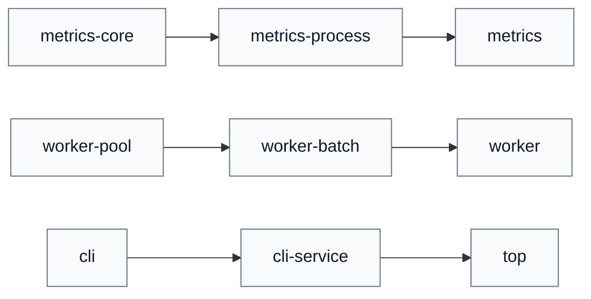

# Feature flags

The defaults are the minimum (`config`, `logger`), so the
"I-just-want-config" use case avoids most transitive deps. Every other
feature is opt-in.

What a feature does is in the subsystem doc each row links. This page says which features to enable and what each costs.

---

## Defaults

```toml
[dependencies]
scalo = "<version>"   # default features: config, logger
```

That's it. The default set covers:

- 7-layer config cascade, with YAML parsed through `scalo::yaml`
- Structured logging via `tracing-subscriber`

If those two are all you need, stop here.

---

## Tier-split features (the not-so-obvious ones)

Three features ship in tiers, and each tier includes the one before it, so a caller pays for the tier it picks.



*Figure 1. L4 Detail -- Feature tiers. An arrow points at the feature that includes the one before it.* Up: [L3 Components -- scalo](README.md).

### Metrics

| Feature | Adds |
| --------- | ------ |
| `metrics-core` | scalo's dependency on the `metrics` crate. No exporter and no `scalo::metrics` API |
| `metrics-process` | Above + `sysinfo`, which the cgroup-aware process gauges (RSS, CPU, FDs) use. Exposes no API on its own: the gauges come with `metrics` or `otel-metrics` |
| `metrics` | Above + Prometheus exporter, `/metrics` HTTP endpoint, manifest dump, and `otel-metrics` and `otel-tracing` for OTLP metric push and span export |

Pick `metrics` for service binaries. scalo's series, the tiered sink's and the transports' among them, are compiled only when `metrics` is on somewhere in the build. A library that emits series of its own depends on the `metrics` crate directly and leaves the exporter to the service. See [core-pillars/metrics.md](core-pillars/metrics.md#feature-tiers).

### Worker pool

| Feature | Adds |
| --------- | ------ |
| `worker-pool` | `AdaptiveWorkerPool` (rayon + tokio) with pressure-based scaling |
| `worker-batch` | Above + `BatchEngine` (SIMD JSON via `sonic-rs`, field interning via `dashmap`) and the `parse_guard` JSON depth pre-check (`wide`) |
| `worker` | Alias for `worker-batch` -- back-compat |

### CLI

| Feature | Adds |
| --------- | ------ |
| `cli` | `clap`-based `CommonArgs`, `StandardCommand`, `VersionInfo`, output helpers |
| `cli-service` | Above + `ServiceApp` trait, `run_app`, `ServiceRuntime` (pulls `health + metrics + memory + scaling + shutdown + governor + lifecycle`). `health` is what lets a transport, a circuit or a paused gate fail `/readyz`. No transport comes with it: add the `transport-*` backends, and `sink-stack` for `outbound_sink_stack`. The worker pool is opt-in: add `worker-pool`, or `worker-batch` for the pool plus `BatchEngine` |
| `lifecycle` | Idle-until-configured gate (`WorkState`, `IdleGate`, `pipeline_idle`) -- folded into `cli-service` |
| `top` | Above + `ratatui` TUI metrics dashboard |

### Transport

| Feature | Adds |
| --------- | ------ |
| `transport` | Base trait architecture, factory, `AnySender`, and the `parse_guard` JSON depth pre-check (`wide`) |
| `transport-trace` | Above + W3C traceparent propagation (pulls `opentelemetry`) |
| `transport-memory` / `-kafka` / `-grpc` / `-file` / `-pipe` / `-http` | Individual backends -- each pulls its deps and no others. `-grpc` and `-http` pull `tls` for their client TLS |
| `transport-kafka-config` | `transport::kafka`'s config and token types with no client: `KafkaConfig` and `validate`, the provider presets, `KafkaToken`, `PartitionLease` and the profile constants. Builds and links no librdkafka. `transport-kafka` includes it |
| `transport-grpc-vector-compat` | Vector.dev wire-compat for a transform consumer |
| `transport-syslog` | Syslog over TCP, TLS, UDP and RELP, send only ([transport/syslog.md](transport/syslog.md)). Pulls `tls`, `jiff` and `sysinfo` |
| `transport-otlp` | OTLP log records to a collector over gRPC or HTTP/protobuf, send only ([transport/otlp.md](transport/otlp.md)). Pulls `tls`, `reqwest`, `tonic` and `opentelemetry-proto`, and needs no `protoc` |
| `transport-all` | All seven backends |

Pick backends explicitly. `transport-all` is a convenience for tests. In
production apps list what you use.

### DLQ

| Feature | Adds |
| --------- | ------ |
| `dlq` | File backend (always available), and the `parse_guard` depth check (`wide`) that keeps a deep original out of `_json` |
| `dlq-kafka` | Above + Kafka backend (pulls `transport-kafka`) |
| `dlq-http` | Above + HTTP backend (pulls `reqwest`) |

### Secrets

| Feature | Adds |
| --------- | ------ |
| `secrets` | `SecretsManager`, the `SecretProvider` trait and the file backend |
| `secrets-vault` | Above + OpenBao/Vault backend (`vaultrs`) |
| `secrets-aws` | Above + AWS Secrets Manager backend (`aws-sdk-secretsmanager`) |
| `secrets-all` | Vault + AWS |

### OpenTelemetry

| Feature | Adds |
| --------- | ------ |
| `otel` | Umbrella -- SDK, OTLP exporter |
| `otel-metrics` | Above + bridge `metrics` crate -> OTLP, with `dashmap` holding one handle per metric key |
| `otel-tracing` | Above + bridge `tracing` crate -> OTLP (closes the W3C distributed-tracing chain when paired with `transport-trace`) |

For full distributed tracing through Kafka/gRPC, enable
`otel-tracing` + `transport-trace`. `transport-trace` alone writes a
`traceparent` only while an OpenTelemetry span is active, which takes
`otel-tracing` or a tracer the app installs, and it exports no spans.

### Directory config

| Feature | Adds |
| --------- | ------ |
| `directory-config` | YAML directory store with file locking (pulls `yaml`) |
| `directory-config-git` | Above + `git2` for commit/push of config changes |

---

## Standalone features

| Feature | Adds |
| --------- | ------ |
| `yaml` | `scalo::yaml`: parse and emit YAML with scalo's rules, budgets, located errors and unknown-key reports -- pulls `serde-saphyr` (safe Rust, no libyaml), `serde_ignored` and `serde_json`. On with `config`, `directory-config` and `deployment`. See [core-pillars/config.md](core-pillars/config.md#yaml-parsing-rules) |
| `compression` | The zstd, LZ4 and gzip engines behind `scalo::compression` (`Compressor`, `CompressorPool`, `Encoder`, `Decoder`), and tonic's gzip and zstd -- pulls `zstd`, `lz4_flex` and `flate2`. The config types are compiled without it. `tiered-sink`, `io` and `transport-http` pull it. `transport-grpc` and `transport-otlp` turn on tonic's gzip alone, `transport-otlp` adds `flate2`, and `geoip-download` takes `flate2`, so none of them compiles LZ4 or zstd. gRPC zstd needs `compression`. See [compression.md](compression.md) |
| `compression-snappy` | Above + the snappy engine (`snap`), which the tiered sink's `snappy` codec needs. Kafka's snappy is librdkafka's and needs neither |
| `geoip-download` | MMDB database provisioning -- pulls `http` (the shared `HttpClient`), plus `flate2` and `tar` for the provider archive formats. Files onto disk only, no lookup engine. Each download is capped by `auto_download.max_database_bytes` and read as an MMDB before it replaces the local copy. See [api/geoip-download.md](api/geoip-download.md) |
| `auth` | Credential acquisition and placement -- pulls `http` (an exchange is an `HttpClient` call, a placement its signing hook), `arc-swap` for the held credential, and reqwest's `form` and `query` encoders. No signing scheme and no crypto dependency. See [api/auth.md](api/auth.md) |
| `tls` | `scalo::tls`: client TLS (`ClientTls` with a `native`, `platform` or `bundle` trust choice, CA files and a mutual-TLS identity, built by `build_client_tls`, and the older `TlsTrust` root store for `build_client_config`), and server TLS (`ServerTls`) whose certificate reloads from a file or secret, with a handshake helper for any listener. Built with an explicit aws-lc-rs provider -- pulls `rustls` (aws-lc-rs provider only), `rustls-native-certs`, `rustls-platform-verifier`, `rustls-pki-types`, `webpki-roots`, `tokio-rustls`, `arc-swap` and `tokio`. A `*_secret` source needs `secrets` too. With `http-server` it adds `TlsListener` and TLS on `HttpServer`. See [api/tls.md](api/tls.md). Installs no process default. `install_default_provider()` is for an app's `main`, see [runtime/service-runtime.md](runtime/service-runtime.md#tls-servers-install-the-rustls-crypto-provider-in-main) |
| `rules` | Ordered first-match rules that set target fields: native tests or CEL Fast conditions, literal / copy / lookup values, a per-call clamp, hit counters -- pulls `expression` (CEL), `strmatch` (the `regex` test), and `sonic-rs` with the `parse_guard` depth check (`wide`) for reading JSON bytes. With `config-reload` it adds the reload helper. See [pipeline/rules.md](pipeline/rules.md) |

---

## The `full` umbrella

```toml
features = ["full"]
```

Pulls in everything except the features listed under
[What's not in `full`](#whats-not-in-full). Useful for poking around. Not
what you ship.

---

## Native dependencies

Some features pull in `*-sys` crates that link C libraries. The hyperi-ci release build links them statically, so only libgit2 needs a runtime package. A local `cargo build --release` links through pkg-config.

| Feature | `-sys` crate | Build package | Runtime package |
| --------- | -------------- | --------------- | ----------------- |
| `transport-kafka` | `rdkafka-sys` | release: hyperi-ci's static librdkafka and OpenSSL prefix. dev: `librdkafka-dev`, no older than the librdkafka in the resolved `rdkafka-sys` version's `+` suffix. macOS: `cmake` (bundled source) | -- (statically linked) |
| `transport-kafka-config` | -- | -- | -- |
| `directory-config-git` | `libgit2-sys`, `libz-sys` | `libgit2-dev`, `zlib1g-dev` | `libgit2-1.9` (release-specific) |
| `spool` / `compression` | `zstd-sys` | -- (bundled source) | -- (statically linked) |
| `secrets-aws` | `aws-lc-sys` | -- (compiled from source) | -- (statically linked) |

The libgit2 package name has the library version in it, so it differs per base release - the value above is for the default base. The build variables, the full table and the `NativeDepsContract` that wires this into generated artefacts are in [deployment/native-deps.md](deployment/native-deps.md).

---

## Recommended bundles

| App | Features | What it gets |
| --- | --- | --- |
| Tiny library or CLI tool | `config`, `logger` (the defaults) | No metrics endpoint, no transport, no worker pool |
| Tooling-style CLI | `cli`, `config`, `logger` | `clap` types, no service scaffolding |
| Light service (HTTP only) | `cli-service`, `http-server`, `transport-http` | `cli-service` brings `health`, `metrics`, `memory`, `scaling`, `shutdown`, `governor` and `lifecycle`. Add `sink-stack` if the sender sits in the outbound control stack, and `worker-pool` or `worker-batch` if the service processes batches on the pool the runtime builds |
| Full data-plane service | `cli-service`, `config-reload`, `transport-kafka`, `transport-grpc`, `tiered-sink`, `dlq-kafka`, `spool`, `http-server`, `service-metrics`, `deployment`, `version-check`, `expression` | A receiver-style service: Kafka and gRPC transports, a tiered sink that spills to disk, a Kafka DLQ and an HTTP server. [integration.md](integration.md) walks through it |
| Plus distributed tracing | add `transport-trace`, and `otel-tracing` where `metrics` is off | `otel-tracing`, which `metrics` and so `cli-service` pull, exports spans, and `transport-trace` propagates `traceparent` on the wire |

---

## What's *not* in `full`

These are left out of `full` because they are diagnostic, smoke-test or specialty features. Enable them explicitly when you need them.

| Feature | Adds |
| --------- | ------ |
| `deployment-smoke` | Runs `docker build` + `docker run` on the generated Dockerfile as part of tests. Needs a Docker daemon |
| `deployment-test-support` | Test helpers for consumer suites: tool probes, kind clusters, `assert_peak_memory` (a test's peak resident set fails over the contract's memory limit and warns over its request, read from `ResourcesContract`, so no test hard-codes a budget). `assert_peak_memory_of` judges a peak the caller measured, for a child process. With `transport` + `worker-batch` the delivery conformance harness ([deployment/conformance.md](deployment/conformance.md)). On Unix, `test_support::shared_service`: one container per backing service per test run, which the first nextest process creates and every other joins by name, removed by a watcher once the run's nextest process exits. Ports bind the daemon host's loopback, an ssh daemon gets an `ssh -L` tunnel per port, and a remote `tcp://` daemon is refused without `HYPERI_TEST_DOCKER_BIND`. Containers are named under `HYPERI_TEST_CONTAINER_PREFIX` (else `<repo>-test`) and labelled with their owner's host, PID namespace, pid and start time, so a create sweeps a dead owner's containers, and another host's only once their 4 h lease lapses. `start_alone` starts one a test holds by itself, `container_name` and `test_name!` name it, and `lookup` and `pets_allowed` read the `HYPERI_TEST_*` settings from the environment, the project `.env` and the file `HYPERI_TEST_ENV_FILE` names. Pulls `dotenvy` and `tempfile` |
| `worker-msgpack` | MsgPack payload decoding in the `BatchEngine` parse stage (`rmpv`) |
| `top` | The `ratatui` TUI metrics dashboard. Pulls `cli-service` |
| `dangerous-diagnostics` | `dump_effective_unredacted()`, the effective config with no redaction, for one-off operator debugging. Off in every shipping build |
| `transport-kafka-test-support` | Kafka fixtures for a consumer's tests, Unix only, in `scalo::transport::kafka::test_support`. It holds `KAFKA_IMAGE` (the one pinned `apache/kafka` image, as `image:tag@digest`), `kafka_tag()` for `testcontainers-modules`, `require_docker()` (skip without Docker locally, fail when `CI` is set), `shared_kafka(suite)`, the run's one PLAINTEXT broker through `shared_service`, `kafka_spec(host_port)` for a broker a test holds alone, and `TlsBroker`, a single-node broker with TLS, mTLS and SASL_SSL SCRAM-SHA-512 listeners and the certificates for them, driven through the docker CLI and named for the suite. Enable it on a dev-dependency. It pulls `transport-kafka`, `deployment-test-support`, `tempfile` and tokio's `process`, and needs a Docker daemon when the tests run |
| `transport-proxy-test-support` | A real Squid for proxy tests, Unix only, in `scalo::transport::proxy::squid`. `Squid::shared()` is the run's one container through `shared_service`, with a URL for a proxy that opens any tunnel, one that opens port 443 only (403), one that wants credentials (407) and the same with the right ones. `TARGET_HOST` resolves only inside Squid, to the machine running the tests, and `password()` is the run's random proxy password. The Docker daemon has to run on that machine. It pulls `transport-proxy`, `deployment-test-support` and `uuid` |
| `transport-test-support` | Send-path fixtures in `scalo::transport::test_support`. `shaped::ShapedSender` is a `TransportSender` whose call latency, per-record and per-KiB cost, confirmation window, all-or-nothing or per-record outcome, byte-capped queue, calls-in-flight cap and faults (slow, down, refuse a record, stall) are set by `ShapedConfig`, on tokio's clock so a paused-time test runs it in virtual time. `kafka_like()` and `grpc_like()` are the two presets, and `PRESETS_CALIBRATED` says whether their numbers came from the real transports. `delivery` holds the `DeliveryApproach` trait, its registry by name, and the memory-guard lease every approach takes for a batch. The `delivery_path` bench and `tests/delivery_invariants.rs` run on it. Pulls `transport`, `memory` and `futures-util` |
| `testcontainers` | Builds scalo's real-broker tests, and with `secrets-vault` its OpenBao tests, which need a Docker daemon. Implies `transport-kafka-test-support`, which holds the image pin, and `transport-proxy-test-support`. They run on the run's shared broker and shared OpenBao, except a test that stops or pauses its broker, which holds one alone. nextest runs at most three of those at once, the `own-broker` test group in `.config/nextest.toml`. [tests/TESTING.md](../tests/TESTING.md) says which tests are core and which full |

---

## Feature edges you should know about

A handful of dependencies aren't visible from the feature name alone:

- `config`, `directory-config` and `deployment` each pull `yaml`, so every
  YAML scalo reads or writes goes through `scalo::yaml`. No feature pulls
  `serde_yaml`, `serde_yaml_ng` or `unsafe-libyaml`, and figment is built
  without its `yaml` feature.
- `directory-config` turns on serde_json's `preserve_order`, so a table
  written back keeps its key order. Cargo unifies features, so every
  `serde_json::Map` in a build with `directory-config` keeps insertion order.
  `config-schema` does the same through schemars.
- `worker-batch` pulls `worker-pool` and `metrics`. `BatchEngine` is
  metric-aware.
- `parse_guard` -- `json_depth_within` and `MAX_PARSE_DEPTH`, the nesting-depth check to run before parsing untrusted JSON -- compiles with `transport`, `worker-batch`, `rules` or `dlq`, and each pulls `wide` for its SIMD byte compares. There is no feature for the guard alone.
- `rules` pulls `strmatch`, so its regex crates come along even when no row uses the `regex` test, and `expression`, so `cel` comes too.
- `tiered-sink` pulls `tokio`, `tokio-util` (its shutdown token), `compression` for its spill codec, and the spill cache's crates (`notify`, `sysinfo`, `futures-util`, `semver`), not the `spool` feature. Its `snappy` codec needs `compression-snappy` as well: `TieredSink` keeps a separate cache, and the standalone `Spool` type needs `spool`.
- `spool` and `tiered-sink` both compile `src/yaque`, scalo's copy of yaque 0.6.6. It pulls `notify` to wake a waiting receiver, `sysinfo` to see whether a lock's owner still runs, `futures-util` and `tracing`.
- `spool` pulls `semver`, which checks a queue's version file, and `tokio`: `Spool::open` opens the queue on tokio's blocking
  pool, so it needs a tokio runtime.
- `dlq` needs `concurrency` (for the `BackgroundSink` actor that
  drains queued entries). `metrics`, `worker-pool`, `tiered-sink` and `transport-kafka` pull it for their `PeriodicWorker` timers, and it adds no crate any of them lacked.

Across the service stack:

- `cli-service` reaches across the stack -- `health + metrics + memory + scaling + shutdown + governor + lifecycle`. It pulls no transport, so a control or admin service built on it compiles none, and `ServiceRuntime::outbound_sink_stack` needs `sink-stack` declared. It does not pull `worker-pool` either, so rayon is compiled only by a service that asks for `worker-pool` or `worker-batch`.
- `top` pulls `cli-service` (and through that, the full L2 runtime).
- `expression` pulls the `cel` crate. A transport filter needs it for
  Tier 2 or Tier 3 CEL (see
  [transport/filter-engine.md](transport/filter-engine.md)), and `rules`
  pulls it for its CEL conditions.
- `auth` pulls `http`, and turns on reqwest's `form` and `query`
  encoders. reqwest gates both behind features, so a build with `http`
  alone has neither -- `geoip-download` turns on `query` for the same
  reason.

---

## Verifying your feature set

```bash
# What does my feature set pull in?
cargo tree --features "cli-service,transport-kafka,deployment"

# Which transitive crates does each feature add?
cargo hack --each-feature --no-dev-deps check --lib

# Build with only defaults -- should compile clean
cargo check --no-default-features --features "config,logger"
```

The third command is the regression: if your patch breaks the
defaults-only build, the trim-the-defaults discipline is broken.
