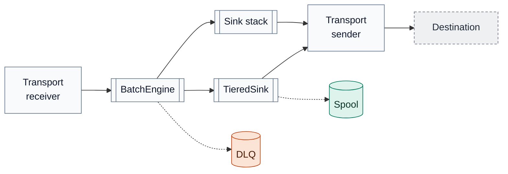

# Pipeline

The hot path: what happens to a batch between arriving on a transport and
landing at its destination. Everything here is opt-in behind a feature flag --
a service takes the stages it needs.

The through-line is that no stage drops data silently. A stage that cannot keep
up applies backpressure upstream, a sink that fails spills to disk, and a record
no sink can take goes to the DLQ rather than being discarded.

The batch engine hands processed records to the app's sink, a tiered sink or a sink stack around a transport sender, and dotted arrows carry spool writes and dead letters.

*Figure 1. L4 Detail -- Pipeline stages. Dotted arrows are the spill to the spool and the dead letters `with_dlq` writes.* Up: [L3 Components -- scalo](../README.md). Down: [L4 Detail -- Batch engine stages](batch-engine.md), [L4 Detail -- Tiered sink delivery](tiered-sink.md), [L4 Detail -- Sink stack layer order](sink-stack.md).

The engine runs the transform on the `AdaptiveWorkerPool`. A tiered sink and a sink stack are two ways to wrap the sender: the tiered sink adds the spill and a circuit breaker, the sink stack timeouts, limits and retries.

| Doc | Covers |
| --- | --- |
| [batch-engine.md](batch-engine.md) | SIMD parse, pre-route filter, field interning |
| [worker-pool.md](worker-pool.md) | `AdaptiveWorkerPool`, pressure-based scaling |
| [tiered-sink.md](tiered-sink.md) | resilient delivery, disk spillover, circuit breaker |
| [sink-stack.md](sink-stack.md) | timeout / load-shed / concurrency / retry / rate-limit |
| [spool.md](spool.md) | disk-backed async FIFO |
| [dlq.md](dlq.md) | file, Kafka and HTTP backends |
| [strmatch.md](strmatch.md) | 4-tier regex to fast-path matcher |
| [rules.md](rules.md) | ordered first-match rules that set target fields, clamp, hit counters, hot reload |
| [scaling.md](scaling.md) | `ScalingPressure`, KEDA external scaler signal |

For why the pipeline throttles the way it does, read
[../backpressure.md](../backpressure.md) first.
