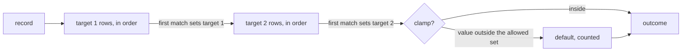

# Rules

`scalo::rules` (feature `rules`) sets target fields on a record from an ordered rule set. For each target in the order the set lists them, the first row in declared order that matches the record and resolves a value sets it. A row tests the record with a native test or a CEL Fast condition, and takes its value as a literal, a copy of a field, or a field mapped through a bounded lookup table.



---

## A rule set

```yaml
name: ingest                   # the rule_set metric label, default "rules"
targets: [_source, _org_id]    # evaluation order
lookups:
  aliases: { logs_syslog: syslog, logs_beats_winlog: windows }
rules:
  - id: category
    set: { _source: { lookup: aliases, from: tags.event.category } }
  - id: web
    match: { field: host, op: starts_with, value: web- }
    set: { _source: { value: web } }
  - id: main
    set: { _source: { value: main } }
  - id: org-tags
    match: { field: tags.event.org_id, op: exists }
    set: { _org_id: { from: tags.event.org_id } }
  - id: windows-org
    when: '_source == "windows" && has(tags.event)'
    set: { _org_id: { value: win-ops } }
```

| Key | Holds |
| --- | --- |
| `name` | The `rule_set` metric label: 1 to 128 letters, digits and `._:/@-`, starting with a letter or digit |
| `targets` | The fields the set assigns, in evaluation order, at most `MAX_TARGETS` (8) |
| `lookups.<table>` | A map of text to text. At most `max_lookup_entries` entries (100,000 by default), no empty key or value |
| `rules[].id` | Stable, unique id: the `rule` metric label and how an editor names the row. Same characters as `name` |
| `rules[].match` | A native test. With neither `match` nor `when` the row always matches |
| `rules[].when` | A CEL Fast condition, in place of `match` |
| `rules[].set` | Exactly one entry: the target field and its action |

Rows are listed in one sequence and grouped by target when they compile, each target keeping declared order. Field paths are dotted (`tags.event.category`) and reach into objects, not arrays.

### Native tests

Every test but `exists` reads the field's text: a string as written, a number or boolean as its JSON text. From raw JSON bytes (`JsonPayload`) a number reads as written, but a `serde_json::Value` formats it with `to_string()`, so `1.50` reads `1.50` from bytes and `1.5` from a `Value`. A missing field, null, an object or an array fails every test, and so passes a negated one.

| `op` | Operands | Holds when the text |
| --- | --- | --- |
| `equals` | `value` | is `value` |
| `starts_with` | `value` | starts with `value` |
| `ends_with` | `value` | ends with `value` |
| `contains` | `value` | contains `value` (a `memchr` finder built at compile) |
| `prefix_and_suffix` | `prefix`, `suffix` | starts with `prefix` and ends with `suffix` |
| `length` | `min`, `max`, either open | is `min` to `max` characters long |
| `exists` | none | is present and not empty, or the field is an object or array |
| `regex` | `value` | matches the pattern, compiled by `strmatch`. Refused unless the CEL Fast profile sets `allow_regex` |

`negate: true` inverts any test. `all: [...]` holds when every part does, and takes `negate` too. A test given an operand it does not take is refused.

A route filter table written with separate match types maps onto these:

| Match type | Here |
| --- | --- |
| `exact`, `starts_with`, `ends_with`, `contains`, `prefix_and_suffix` | the op of the same name, `exact` as `equals` |
| `not_contains`, `not_starts_with`, `not_ends_with` | the op with `negate: true` |
| `length_min`, `length_max`, `length_range` | `length` with `min`, `max` or both |

### CEL Fast conditions

`when` compiles under the CEL Fast profile ([../../src/expression/profile.rs](../../src/expression/profile.rs)): the options' `profile`, or `expression.*` from the config cascade for `RuleSet::compile`. Each top-level name the condition reads resolves lazily, from an earlier top-level target's new value or from the record. A condition that is not `true`, or fails to evaluate, does not match.

The profile scanner reads the condition as cel's lexer does. A function name inside a string or bytes literal (quoted, triple-quoted or raw, with the `r`, `R`, `b`, `B`, `br`, `bR`, `Br` or `BR` prefix), a `//` comment or a backtick-quoted name is not a call, and whitespace or a comment between a name and its `(` still makes it one.

### Actions

| Action | Value | When it finds nothing |
| --- | --- | --- |
| `{ value: text }` | the literal | never, so a literal row shadows the rows its test covers |
| `{ from: field }` | the field's text | no match, the next row runs |
| `{ lookup: table, from: field }` | the table's entry for the field's text | no match, the next row runs |

Empty text reads as no value everywhere: `from` an empty field does not match, and an empty `value` or table entry is refused.

### Targets in order

A row for a later target that reads an earlier target's field reads the value this pass set, when a row set one, else the record's. An earlier target reads the record's value of a later one. So with `targets: [_source, _org_id]` an org row can test the source the same pass chose.

---

## Compile and check

```rust
use scalo::rules::{CompileOptions, RuleSet};

let set = RuleSet::compile(&config)?;                 // cascade profile
let set = RuleSet::compile_with(&config, &options)?;  // explicit
let findings = RuleSet::check(&config, &options);     // never fails
```

One pass reports every finding, so an editor shows them all at once. A `RuleDiagnostic` carries:

| Field | Holds |
| --- | --- |
| `severity` | `Error` stops the set compiling, `Warning` does not |
| `location` | The config location, e.g. `rules[2].match.value`, `targets[0]`, `lookups.aliases` |
| `rule` | The id of the row it concerns |
| `message` | What is wrong |
| `span` | For `when`, the byte range in the condition: the function name the profile scanner refused, or the character the parser stopped at |

Warnings are reported once the set has no errors. Errors: a duplicate or malformed id, a row setting zero or several targets or one the set does not list, `match` beside `when`, a missing or stray operand, `regex` with the profile off, a pattern that does not compile, a lookup naming no table, an empty literal, a table over its bound, a CEL condition the profile refuses or that does not parse. Warnings: a row an earlier row of the same target always fires before, because the earlier row sets a literal and is unconditional, has the same test, or is a plain `exists` on the field the later row needs. `RuleSet::warnings()` keeps the warnings of a compiled set.

`tests/fixtures/rules_corpus.json` pins findings, spans and outcomes, and is the parity fixture a scalo-py implementation is tested against.

---

## Evaluate

```rust
use std::collections::HashSet;
use scalo::rules::{Clamp, JsonPayload};

let record = JsonPayload::new(payload_bytes).ok_or("nested too deep")?;
let outcome = set.evaluate(&record);

let org = set.target("_org_id").ok_or("no target")?;
let allowed: HashSet<String> = principal_orgs();
let outcome = set.evaluate_clamped(&record, &Clamp::new(org, &allowed, "default"));
for (field, assignment) in outcome.iter() {
    write_field(field, assignment.value());
}
```

A record is anything that implements `FieldSource`. `JsonPayload` reads raw JSON bytes lazily with sonic-rs and builds no DOM, after the `parse_guard` depth check (`JsonPayload::trusted` skips it for bytes already checked). `serde_json::Value` implements it for a parsed record. An outcome borrows from the set and the record and holds at most `MAX_TARGETS` assignments inline. Native rows over `JsonPayload` allocate only to copy a string that holds escapes. A `serde_json::Value` number is formatted to text, and a CEL condition allocates the values it reads.

| Outcome | Holds |
| --- | --- |
| `get(target)` / `value(target)` | The assignment, `None` when no row set it and the clamp left the record's value |
| `iter()` | Each assigned field with its value and row, in target order |
| `clamp()` | `Kept`, `Replaced { was, rule }` or `Defaulted`, `None` without a clamp |

`set.target(field)` returns a `TargetId`, an index into the set it came from. On another set it names that set's target at the same position, or nothing when that set has fewer targets, so a caller that keeps one must resolve it again after a reload.

### The clamp

`Clamp::new(target, allowed, default)` is per call, so each credential or listener brings its own allowed set. After every target is set, the clamp target's final value -- the row's, else the record's own -- is checked against `allowed`. A value outside it becomes `default` (`Replaced`, naming the row that produced it). No value at all becomes `default` (`Defaulted`). The check is one hash-set lookup. The caller keeps `default` inside `allowed`.

### Counting

Every row counts the records it set its target on, and the clamp counts what it replaced, per row and for values the record carried.

| Read | From |
| --- | --- |
| `set.usage()` | Per row: id, target, hits, clamped, since the set compiled |
| `set.record_clamped()` | Replaced values no row set |
| `rules_hits_total{rule_set, rule}` | With the `metrics` feature, cumulative across reloads |
| `rules_clamped_total{rule_set, rule}` | With the `metrics` feature. `rule="(record)"` for a value the record carried |

`set.evaluate` adds each count to a shared atomic. `set.batch()` counts in a local tally and adds it once on `flush()` or drop, so threads evaluating in parallel share no counter per record.

---

## Hot reload

Rules live in a section of the app's config file and reload through `ConfigReloader` (feature `config-reload`):

```rust
use std::sync::Arc;
use scalo::config::reloader::ReloaderConfig;
use scalo::config::shared::SharedConfig;
use scalo::rules::{CompileOptions, RuleSet, reloader};

let options = CompileOptions::from_cascade();
let set = RuleSet::from_file_section(&path, "routing.rules", &options)?;
let shared = SharedConfig::new(Arc::new(set));
let _watch = reloader(
    ReloaderConfig { config_path: Some(path.clone()), enable_sighup: true, ..Default::default() },
    shared.clone(),
    "routing.rules",
    options,
)?
.start();

// Per batch: one read lock and an Arc clone.
let rules = shared.get();
```

On each change the section is read and compiled, and the new set replaces the old only when it compiles. A file that fails to read, parse or compile leaves the running set in place, logs the error and counts `config_reloads_total{result="error"}`.

List the section in the deployment contract's `hot_paths` ([../deployment/contract.md](../deployment/contract.md#hot-paths)). The scalo-service chart then leaves it out of the pod's config checksum, so an edit reaches the mounted file and this reloader without rolling the pods.

---

## Benchmarks

`benches/rules_benchmark.rs` times evaluation over raw bytes: the first row, the twentieth row on one field, a two-target lookup and copy with and without the clamp, and a CEL condition. `scripts/bench-gate.sh` fails a change whose median for any of them is over 5% slower than a saved baseline:

```bash
git switch main       && cargo bench --features rules --bench rules_benchmark -- --save-baseline base
git switch my-change  && cargo bench --features rules --bench rules_benchmark -- --baseline base
scripts/bench-gate.sh
```

---

## Related

- [strmatch.md](strmatch.md) -- the engine behind the `regex` test
- [../transport/filter-engine.md](../transport/filter-engine.md) -- drop and DLQ filters on a transport
- [../core-pillars/config.md](../core-pillars/config.md#hot-reload) -- `ConfigReloader` and `SharedConfig`
- [../feature-flags.md](../feature-flags.md) -- `rules`, `expression`, `config-reload`
- Source: [../../src/rules/mod.rs](../../src/rules/mod.rs)
