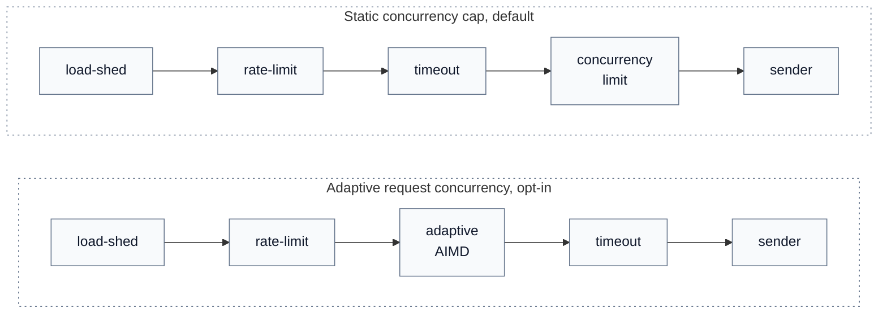
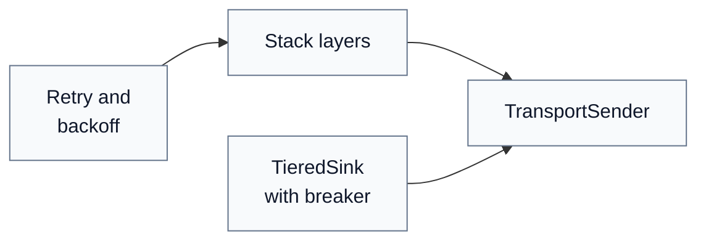

# Sink-stack (outbound control stack)

`sink-stack` wraps any `TransportSender` so every outbound sink gets timeout,
concurrency limiting, load-shedding, rate-limiting and retry/backoff for free,
without each sink re-deriving them. It is opt-in (`sink-stack` feature) and
every knob defaults to behaviour-preserving values, so wrapping a sender with
the default config changes nothing until you turn a control on.

The controls are not independent: their **order** decides what a timeout
covers, and it differs between the two concurrency modes.

## Layer order

Composed with tower's `ServiceBuilder`, outer to inner: under the static cap the timeout wraps the concurrency gate, and under ARC the adaptive limiter wraps the timeout.

*Figure 1. L4 Detail -- Sink stack layer order. Load-shed is there only with `load_shed: true`, and the bytes leave at the sender.* Up: [Pipeline](README.md).

The difference that bites: under the static cap the **timeout wraps the
concurrency gate** (a request waiting for a slot can still time out). Under ARC
the **adaptive limiter wraps the timeout**, so a timed-out or errored attempt
feeds the AIMD decrease and a fast success feeds the increase -- the limiter
learns the downstream's safe concurrency from RTT and error feedback.

ARC's `min_limit` floors at 1, so a failing sink can never deadlock the limiter
at zero. It is the OUTBOUND limiter only, kept distinct from the inbound
worker-pool AIMD so the two never double-regulate. When saturated the limiter
backpressures and never drops: a request waiting for a slot parks on a tokio
semaphore, so it costs no CPU. Pair ARC with `load_shed` where a sustained
overload should shed requests rather than queue them.

## Retry and the circuit breaker live outside the stack

Retry/backoff wraps the whole composed service as the OUTERMOST control (driven
by `backon`), so each retry re-enters at `load-shed` and every attempt is
independently timeout-bounded. Circuit-breaking is deliberately NOT a layer
here: the `TieredSink` wraps its sink in a breaker of its own, and a second
one would double-regulate.

*Figure 2. L4 Detail -- Retry and the breaker around a sender. The tiered sink is a separate wrapper, not a layer of the stack.* Up: [Pipeline](README.md).

## Delivery guarantee (at-least-once preserved)

- Rate-limit and concurrency-limit only DELAY admission. They never drop.
- Retry re-sends the WHOLE batch on a transient failure. Records are held behind
  an `Arc`, so a retry is a refcount bump, not a copy.
- A fatal error stops immediately -- no point retrying a permanent failure.
- The call returns a `SinkOutcome`: the `SendResult` for the records sent, and
  `dead_letters`, the records the sender would or did dead-letter. The caller
  writes the dead letters to its DLQ and fires its commit tokens only on
  `SendResult::Ok`. Retries may re-deliver records a failed attempt sent -- a
  prefix for the per-record default, any subset for Kafka's pipelined override
  (at-least-once: duplicates, never loss).
- Records the sender names in `dead_letter_reason` are taken out before the
  send. A send it answers `FilteredDlq` names no record, so the stack sends
  that batch's records again one at a time, and each one refused joins the dead
  letters as `DeadLetterReason::Rejected`. The resend repeats the records already
  sent. A `FilteredDlq` is never retried as a whole and never counts as sent.
- In a `BatchEngine` pipeline, the sink hands the dead letters back through
  `pieces.refusals()`, and the loop writes them to the DLQ before it releases
  the source ([acknowledgements.md](acknowledgements.md#pieces-and-release)).

## Configuration

Loaded from the cascade under `sink_stack` (`SinkStackConfig::from_cascade`), or
an explicit key via `FromCascade::from_cascade_key`. An absent section takes the
defaults, and one that does not parse is `TransportError::Config` naming its key.
Defaults preserve behaviour: no concurrency cap, ARC off, queue-don't-shed.

| Key | Default | Meaning |
| ----- | --------- | --------- |
| `max_concurrency` | `0` | Static in-flight cap, `0` = uncapped. Ignored when `adaptive` is set |
| `adaptive` | unset | Enables ARC (AIMD limiter), replacing the static gate |
| `attempt_timeout_ms` | `30000` | Per-attempt timeout |
| `load_shed` | `false` | Shed (fail-fast) instead of queueing when the inner service is not ready |
| `max_retries` | `3` | Retry attempts on transient failure |
| `min_backoff_ms` | `100` | Exponential backoff floor |
| `max_backoff_ms` | `30000` | Exponential backoff ceiling |
| `rate_limit` | off | Token-bucket admission rate (see `RateLimitConfig`) |

ARC sub-knobs (`adaptive`): `initial_limit` (`10`), `min_limit` (`1`),
`max_limit` (`100`), `increase_by` (`1`), `decrease_factor` (`0.5`).

See [tiered-sink.md](tiered-sink.md) for the breaker and spool delivery
path that sits around the sender, and [../self-regulation.md](../self-regulation.md)
for the inbound side that the outbound ARC is kept separate from.
