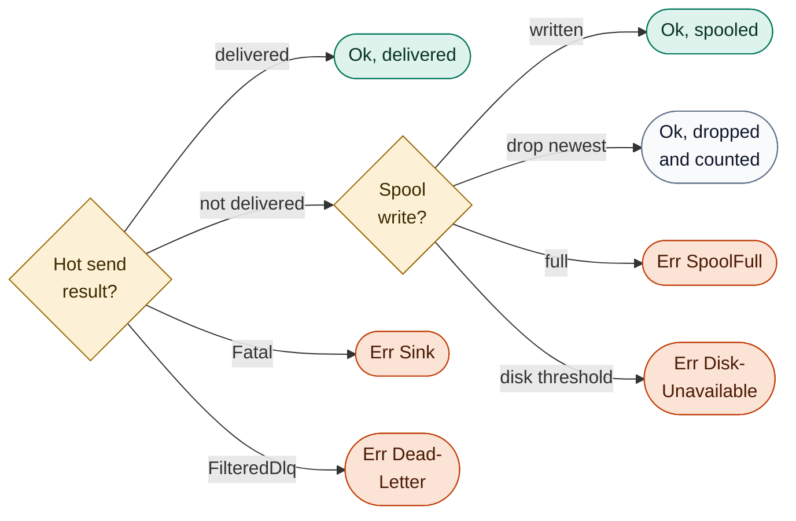
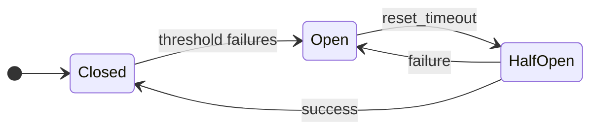

# Tiered Sink

`TieredSink<S>` wraps any `TransportSender` (Kafka, gRPC, HTTP, file, pipe, or the factory's `AnySender`) with the resilience primitives every production data-plane pipeline needs -- timeout, circuit breaker, disk spillover, background drain. Apps call `sink.send(&record).await?` and the sink picks the right failure response.

It is the resilient-delivery primitive: put every downstream write in the data plane behind one.

---

## What it composes

A send goes to the sender when the breaker admits it, spills to the spool when the sender cannot take it, and reaches the caller as an `Err` for a fatal send or a spool write that fails.



*Figure 1. L4 Detail -- Tiered sink delivery. Green ends return `Ok`, orange ends `Err`, and the plain end `Ok` for a record it dropped.* Up: [Pipeline](README.md).

The hot send is one `send_batch`, bounded by `send_timeout_ms`, made when the breaker admits it and, under `StrictFifo`, the spool is empty. Not delivered covers a breaker refusal, `Backpressured` and a timeout. Spool writes encode and compress (zstd, LZ4 or snappy) and append to the spill queue with one write, and a background drain sends the spool on once the breaker admits. A spill under 64 KiB is written on the calling task, where it takes microseconds. A larger one, or one that starts a segment file, is written on tokio's blocking pool.

A `disk_capacity_poller` watches the spool filesystem when
`disk_aware` is configured -- if usage crosses the threshold the
`disk_available` flag flips and new spool writes return
`DiskUnavailable` instead of filling the disk. It reads `statvfs` on Linux and macOS, and `GetDiskFreeSpaceExW` on Windows.

Each `send_batch` answer and what the sink does with it:

| `send_batch` result | Disposition | Circuit effect |
| ------------- | ------------- | ---------------- |
| `Ok` | `Ok` to the caller | Success recorded: failure count reset, circuit closes |
| `FilteredDlq` | `Err(TieredSinkError::DeadLetter)` to the caller. Not spooled | Success recorded |
| `Backpressured` | Spool to disk | Failure recorded and counted in `spool_circuit_trips_total`, may open the circuit |
| `Fatal(e)` | `Err(TieredSinkError::Sink)` to the caller, with `e` as the cause | None. Not spooled |
| No answer within `send_timeout_ms` | Spool to disk | Failure recorded and counted in `spool_circuit_trips_total`, may open the circuit |

Before any of that, `send` asks the sender's `dead_letter_reason`, and a record it names comes back as `Err(TieredSinkError::DeadLetter)` without being sent or spooled. The caller holds that record, so it writes it to its DLQ, as it does for `Sink` and `SpoolFull`.

The drain has no caller to hand a record back to. A spooled record the sender names, answers `FilteredDlq` for, or refuses with `Fatal` when sent on its own goes to the DLQ set with `TieredSink::with_dlq(Arc<Dlq>)`, with the cause as its reason, and its spool entry is committed only once the DLQ confirms it. A DLQ that does not confirm within `send_timeout_ms` leaves the batch spooled for the next pass. A dead letter a Kafka-only DLQ's broker refuses for its size (`DlqError::Refused`) is dropped and counted as `dropped`, and the rest of the batch is committed, while `when_full: dlq` blocks on such a record instead. With no DLQ such a record is dropped, logged at ERROR and counted in `tiered_sink_dead_letters_total{outcome="dropped"}`. A `Fatal` of `TransportError::Config` or `Closed` describes the sink and not the record (a Kafka sink whose credentials are refused, say), so the record stays spooled and the circuit counts a failure until the sink is fixed.

---

## Circuit breaker

The breaker opens on consecutive failures and probes once from half-open, evaluated per `send` and per drain pass.



*Figure 2. L4 Detail -- Circuit breaker states. A label names what moves the breaker.* Up: [Pipeline](README.md).

- Closed -- hot path active, failures counted.
- Open -- hot path skipped, every message goes straight to spool.
- Half-open -- one probe allowed, taken by whichever of a `send` or the drain asks first. Success -> Closed, failure -> Open. A probe that records neither, because its future was dropped or its outcome counts as neither, is lost once `reset_timeout` has passed since it went out, and the next caller probes again.

Hooks into the global `HealthRegistry` (when `health` feature is on)
so `/readyz` reports the sink as Degraded (HalfOpen) or Unhealthy
(Open).

See [`../../src/tiered_sink/circuit.rs`](../../src/tiered_sink/circuit.rs).

---

## Ordering modes

| Mode | Hot path policy | Trade-off |
| ------ | ----------------- | ----------- |
| `Interleaved` (default) | Always try hot path when circuit allows | Max throughput, and new messages may arrive before older spooled ones |
| `StrictFifo` | Hot path only when spool is empty | Strict order, and new traffic queues behind drain |

`StrictFifo` is the mode where every spooled record leaves before any record sent after it. While the spool holds a record, `send` spools behind it rather than taking the hot path, and one gate serialises each `send` against each drain pass, so the sink sees records in the order `send` took them. Pick it when downstream ordering matters (transaction log replication, append-only stores). Most pipelines accept the interleave for the throughput win.

---

## Drain strategies

The background drain (`drainer::drain_loop`) pulls from the spool and
re-tries the primary sink at a rate controlled by `DrainStrategy`:

| Strategy | Behaviour |
| ---------- | ----------- |
| `Adaptive { initial_rate, max_rate }` (default) | Start slow (100 msg/s), accelerate based on success rate, cap at `max_rate` (10 000 msg/s) |
| `RateLimited { msgs_per_sec }` | Fixed rate |
| `Greedy` | Drain as fast as possible -- risks overwhelming a recovering sink |

Each pass takes up to `drain_batch_max_records` (500) records and `drain_batch_max_bytes` (4 MiB, counted as stored after compression and framing), no more than a second's worth at the strategy's current rate, and sends them in one `send_batch` under one `send_timeout_ms`. Records the sender names in `dead_letter_reason` are taken out first. Every entry is committed only when the sink answers `Ok` and the DLQ holds the dead letters. `Backpressured`, a timeout, or `Fatal(Config)`/`Fatal(Closed)` rolls the whole batch back, so a retry can deliver part of it twice, never lose it. Any other `Fatal`, and a `FilteredDlq`, names no record, so the batch is kept and its entries are sent one at a time, which dead-letters only the record the sink rejects. An entry that fails its CRC is dropped, counted in `spool_damaged_entries_total` with one warn, and the rest of its batch is sent. One in a codec this build lacks, or that does not decompress or decode, holds the drain ([Changing the codec](#changing-the-codec)).

A pass reads on tokio's blocking pool and commits there too, since a commit can delete a segment file and save the read position. No lock is held across the send. With `with_memory_guard(guard)`, each record's length is reserved before it is read and released when the pass commits or returns its records. A refused reservation ends the pass's read early, after its first record and never before it, so a pressed process drains in smaller batches and still drains. A record whose 4-byte header fails its parity check leaves nothing after it to find, so the spill is quarantined and a fresh one opened. A spool that counts records its drain does not find for 50 passes in a row sets `tiered_sink_drain_stalled` and degrades readiness.

A pass that takes records starts the next after the strategy's pause for that many records, so the strategy sets the rate. `drain_interval_ms` (100 ms) is added after a pass that found the spool empty or the sink down. Shutdown cuts either wait short.

The drain task is spawned at construction. It and the disk poller both stop when the sink's shutdown `CancellationToken` is cancelled, by `shutdown()` or by drop. With the `shutdown` feature the drain task stops on the global token.

Each drain send is bounded by `send_timeout_ms`, the limit the hot path uses. A send that runs past it counts as a circuit failure. The record stays at the head of the spool, uncommitted, and is offered again on the next drain pass. The downstream may have taken the record before the timeout, so the retry can duplicate it (at-least-once).

---

## Spool sizing and disk awareness

- `max_spool_items` -- record limit for the spool.
- `max_spool_bytes` -- most bytes the spool's files take on disk. Each record counts as stored, compressed and framed, plus its 4-byte header. The records a segment has delivered stay on disk until the whole segment goes, so one segment's worth of the cap is held back for them, and with a cap the segment shrinks to a quarter of it. The files then stay within the cap, give or take one record.
- `disk_aware: { max_usage_percent, poll_interval_secs }` -- background
  poller, `statvfs` on Linux and macOS and `GetDiskFreeSpaceExW` on Windows
  ([../platforms.md](../platforms.md)). Once filesystem use crosses the threshold,
  `disk_available` flips false and spool writes return
  `DiskUnavailable`. A `poll_interval_secs` of 0 reads as 1.

On a Kubernetes emptyDir `statvfs` reads the node's disk, not the volume's `sizeLimit`, so a spool past the limit gets the pod evicted and the spool lost. The scalo-service chart sets `SCALO_WRITABLE_PATH_LIMITS` to each emptyDir writable path with a `sizeLimit`. With `max_spool_bytes` unset, `TieredSink::new` caps a spool on such a path at nine tenths of its limit. On Kubernetes, `disk_aware` with no cap at all is refused with `SpoolOpen`.

A spill reserves its item slot and bytes before it writes, and gives them back if the write fails or the `send` future is dropped, so a cancelled spill leaves nothing counted. A spill past `max_spool_items` or `max_spool_bytes` applies `when_full`:

| `when_full` | `send` returns |
| --- | --- |
| `block` (default) | `Ok` once the drain frees room within `when_full_wait_ms` (1000 ms), else `Err(TieredSinkError::SpoolFull)`. Never drops |
| `drop_newest` | `Ok`. The record is dropped and counted in `tiered_sink_dropped_total{policy="drop_newest"}` |
| `dlq` | `Ok` once the DLQ set with `with_dlq` confirms the record, counted in `tiered_sink_overflow_total{policy="dlq"}`. With no DLQ, or no confirmation within `send_timeout_ms`, behaves as `block` |

A blocked `send` waits outside the `StrictFifo` gate and retries the whole send each time a drain pass delivers, dead-letters or drops records, so the caller is held to the drain's pace. `when_full_wait_ms: 0` returns `SpoolFull` at once.

A disk that fills before either cap (`StorageFull`, a quota, or a file size limit) applies `when_full` too: the spill is cut back, nothing is written, and spills are refused without touching the disk until a retry is due, the wait doubling from 100 ms to 5 s. A spill is tried again at once when the drain deletes a delivered segment, and a blocked `send` woken by that pass tries again. The first spill that fits ends the wait. Readiness is Degraded while the disk is full, `spool_disk_full_refused_bytes_total{store="tiered_sink"}` counts the refused bytes and `spool_disk_full_wait_milliseconds_total` the wait.

Crossing the `disk_aware` threshold returns `Err(TieredSinkError::DiskUnavailable)` whatever `when_full` says. The caller decides what to do with either error -- the typical pattern is to route the record to the DLQ.

The spill's two halves hold OS locks on their lock files, so a killed process holds nothing and `TieredSink::new` opens its spill at once, and a `spool_path` another live sink holds is refused: each sink needs a path of its own. A spill cache that will not open is quarantined into a `corrupt-*` subdirectory of `spool_path`, never by renaming the path. One written in an earlier spool format is cleared and stamped once drained, and refused with `SpoolOpen` while it holds records, with nothing moved ([spool.md](spool.md#quarantine)). A receive position a power loss left unusable is not that case: the sink replays from the first segment instead, so some consumed records come again.

A spill survives the process being killed once `send` returns. It survives a power loss or a node crash once a sync has run. The timed sync runs every `sync_interval_ms` (500 ms, 0 turns it off) on tokio's blocking pool: it flushes the open segment, the directory only when a segment was created since the last sync, and saves the read position. So a power loss loses at most about one interval of spilled records, and a process kill loses none. `shutdown()` runs a last sync. `TieredSink::sync().await` syncs at once, so a caller that accepts records in batches can sync once per batch, and `sync_on_spill: true` syncs inside every spilling `send`, at a disk sync per spilled record on the path that runs when the sink is down. The first sync also flushes every directory up to the root, since opening creates any that are missing. Windows has no directory sync, so there the segment's own flush is the last step. A sync that fails returns `TieredSinkError::Spool` with the record already spilled, so a retry can deliver it twice. See [spool.md](spool.md#locks-after-a-hard-kill).

---

## Changing the codec

Each spilled entry names the codec it was written with, so a change of `compression` applies to new records and the drain reads the ones already spilled under their own. [spool.md](spool.md#compression) says which codec suits which host.

An entry naming a codec this build lacks (snappy without `compression-snappy`), or one that does not decompress or decode under its own, is never dropped: the drain sends what comes before it, then holds with that entry and everything after it on disk. It logs the error once, sets `tiered_sink_drain_held` to `1`, fails readiness (the `tiered_sink_drain` health component) and `is_drain_held()` returns `true`. New records still spill behind it. Open the spill with a build that reads the codec and the drain resumes, in order. An entry that fails its CRC is damaged rather than foreign, and is dropped.

## Configuration

```yaml
tiered_sink:
  spool_path: /var/spool/myapp/clickhouse
  send_timeout_ms: 1000
  compression: {codec: zstd, level: 3}  # the default. Or none, lz4, snappy (compression-snappy)
  drain_strategy:
    type: adaptive
    initial_rate: 100
    max_rate: 10000
  ordering: interleaved
  max_spool_items: 1000000
  max_spool_bytes: 10737418240   # 10 GiB
  when_full: block
  when_full_wait_ms: 1000          # how long a blocked send waits for room. 0 returns at once
  crc: true                        # the default. false writes the CRC as zeros
  on_corruption: quarantine
  sync_on_spill: false             # true syncs to disk before a spilling send returns
  sync_interval_ms: 500            # 0 turns the timed sync off
  segment_bytes: 16777216          # 16 MiB
  read_buffer_bytes: 65536         # 64 KiB
  circuit_failure_threshold: 5
  circuit_reset_timeout_ms: 30000
  drain_interval_ms: 100
  drain_batch_max_records: 500
  drain_batch_max_bytes: 4194304   # 4 MiB, as stored
  disk_aware:
    max_usage_percent: 0.8
    poll_interval_secs: 5
```

A `circuit_reset_timeout_ms` below `send_timeout_ms` logs a WARN naming both when the sink starts. A half-open probe still sending is then lost before its send can time out, so a second probe can join it.

`TieredSinkConfig::new(path)` plus the builder methods cover the
common cases without writing the full struct.

---

## Metrics

Emitted through the `metrics` crate, and only when scalo is built with the `metrics` feature (`metrics-core` alone does not emit them). Names are bare. A `metrics.namespace` prefixes each with `{namespace}_`, see [../core-pillars/metrics.md](../core-pillars/metrics.md). `ServiceMetrics::register` describes every one of them in `/metrics/manifest`.

| Metric | Type | Labels | What it reports |
| --- | --- | --- | --- |
| `spool_hot_path_total` | counter | none | Records the sink took directly, answering `Ok` within `send_timeout_ms` |
| `spool_cold_path_total` | counter | none | `send` calls that ended on the spool path without error. Includes records shed by `drop_newest`, since `send` returns `Ok` for them |
| `spool_circuit_trips_total` | counter | none | Hot-path sends that failed against the breaker (`Backpressured`, or past `send_timeout_ms`). One per failed send, not per Closed-to-Open change. Drain failures are not counted |
| `spool_circuit_state` | gauge | none | Breaker state at the last `send`: `0` closed, `1` half-open, `2` open. Half-open shows once the reset timeout has passed, before a probe goes out. An idle sink keeps its last value |
| `tiered_sink_overflow_total` | counter | `policy` | Records a full spool did not take: `drop_newest` sheds them, `dlq` writes them to the DLQ. `block` returns `SpoolFull` and does not count |
| `tiered_sink_dead_letters_total` | counter | `reason`, `outcome` | Records the drain or `when_full: dlq` could not deliver. `outcome` is `dlq` when the DLQ confirmed it, `dropped` with no DLQ or one no backend can hold it. `reason` is `too_large`, `outbound_filter`, `rejected` (refused when sent) or `spool_full` |
| `tiered_sink_dropped_total` | counter | `policy` | Records dropped on overflow. Moves with `tiered_sink_overflow_total` |
| `tiered_sink_drain_held` | gauge | none | `1` while the drain holds at a spilled entry it cannot read, else `0`. See [Changing the codec](#changing-the-codec) |
| `spool_messages` | gauge | none | Records in the spool, set by each spill and each drain commit. `spool_len()` is the live count. `ServiceMetrics::spool_messages` writes the same series |
| `spool_bytes` | gauge | none | Bytes the spool's records take on disk, each as stored plus its 4-byte header, set with `spool_messages`. `spool_bytes()` is the live figure. `ServiceMetrics::spool_bytes` writes the same series |
| `spool_bytes_in_total` | counter | `store`, `codec` | Bytes of encoded records the spill took in, before compression |
| `spool_bytes_written_total` | counter | `store`, `codec` | Bytes the spill appended to its segment files |
| `spool_codec_microseconds_total` | counter | `store`, `codec`, `op` | Time spent compressing spills |
| `spool_disk_bytes` | gauge | `store` | Bytes the spill's segment files hold |
| `spool_disk_full_refused_bytes_total` | counter | `store` | Bytes refused while the disk was full |
| `spool_disk_full_wait_milliseconds_total` | counter | `store` | Time spent waiting for the disk to have room |
| `spool_sync_seconds` | histogram | `store` | Time one sync took, timed, explicit or `sync_on_spill` |
| `spool_memory_reserved_bytes` | gauge | `store` | Bytes the drain's read holds reserved with the memory guard |
| `spool_drain_cut_short_total` | counter | `store` | Drain reads the memory guard stopped after their first record |
| `spool_position_save_failures_total` | counter | `store` | Read-position saves that failed. A restart then replays more |
| `spool_segment_delete_failures_total` | counter | `store` | Delivered segment files that could not be deleted |
| `spool_torn_entries_cut_total` | counter | `store` | Torn records cut off the end of the spill when it opened |
| `spool_damaged_entries_total` | counter | `store` | Spilled records the drain dropped because they failed their CRC |
| `spool_oldest_age_seconds` | gauge | `store` | Age of the oldest spilled record, from its write time, `0` with none. Set every `drain_interval_ms` |
| `tiered_sink_drain_read_errors_total` | counter | none | Drain passes whose read failed. The first is logged, and the recovery |
| `tiered_sink_drain_stalled` | gauge | none | `1` while the spool counts records the drain has not found for 50 passes, else `0` |
| `spool_disk_available_bytes` | gauge | none | Bytes free to unprivileged users on the spool's filesystem, set every `poll_interval_secs` by the disk poller, so only with `disk_aware` |
| `spool_disk_total_bytes` | gauge | none | Size of that filesystem, set with `spool_disk_available_bytes` |
| `spool_dropped_without_shutdown_total` | counter | none | Sinks dropped with records still spooled and no completed `shutdown().await`. Flat after a clean `shutdown()` |
| `spool_quarantined_total` | counter | `trigger` | A spill cache moved into `corrupt-*` under `spool_path`: `open_failed` when it would not open, `damaged_header` when the drain met a damaged header, or the open met one in the newest segment and moved the segment from it aside. See [spool.md](spool.md#quarantine) |

Alert on:

- `spool_dropped_without_shutdown_total` above 0. A sink was dropped with records still spooled and no completed `shutdown().await`, so fix the caller. Spooled records stay on disk and replay on the next open, but `Drop` does not wait for a drain in flight.
- `tiered_sink_dropped_total` rising. `drop_newest` is discarding records.
- `spool_circuit_state` held at `2`. The sink is down and everything is going to the spool.
- `1 - spool_disk_available_bytes / spool_disk_total_bytes` nearing `max_usage_percent`. Spool writes then return `DiskUnavailable`.
- `spool_quarantined_total` above 0. A spill cache was set aside and its records are not replayed.
- `tiered_sink_drain_held` at `1`. The spill holds an entry this build cannot read, and nothing drains until a build that reads it opens the spill.
- `spool_oldest_age_seconds` climbing. The drain is not keeping up, or the sink is down.
- `spool_damaged_entries_total` above 0. The spill's disk returned damaged bytes.
- `spool_disk_full_refused_bytes_total` rising. The spill's disk is full and records are going to `when_full`.
- `tiered_sink_drain_stalled` at `1`, or `tiered_sink_drain_read_errors_total` rising. The drain cannot read the spill.

No metric counts a `SpoolFull`, `DiskUnavailable` or `DeadLetter` error, which goes back to the caller.

---

## API surface

| Item | Purpose |
| ------ | --------- |
| `TieredSink::new(sender, config)` | Construct, open spool, spawn drain task. `S` is any `TransportSender`, and the sink calls its `send_batch` with one record and acts on the `SendResult` |
| `send(&Record) -> Result<()>` | Hot path, else spool. Errors go back to the caller, which routes the record (usually to the DLQ) |
| `with_dlq(Arc<Dlq>)` | The DLQ the drain writes records it cannot deliver to, and `when_full: dlq` the records a full spool cannot take (`dlq` feature) |
| `with_memory_guard(Arc<MemoryGuard>)` | Reserve each spilled record's length before the drain reads it (`memory` feature) |
| `sync()` | Sync every spill so far to disk, on tokio's blocking pool |
| `spool_len() / spool_is_empty() / spool_bytes()` | Spool depth introspection |
| `spool_state() -> SpoolState` | Records spilled, their bytes as stored, and the oldest's age as of the drain's last pass (`None` when empty). Reads counters, never the disk |
| `circuit_state()` | Current `CircuitState` |
| `reset_circuit()` | Manual reset (admin / test) |
| `hot_path_count() / cold_path_count()` | Cumulative path counters |
| `is_disk_available()` | Disk-aware poller flag |
| `is_drain_held()` | Whether the drain holds at an entry it cannot read |
| `inner() -> &S` | Borrow the wrapped backend |
| `shutdown()` | Stop the drain task, the disk poller and the timed sync, after one last sync, and wait for all three to exit |
| `TieredSinkError` | `SpoolOpen` from `new`. From `send`: `DeadLetter` (the sender named it or answered `FilteredDlq`), `Sink` (a `Fatal` answer, with its cause), `SpoolFull`, `DiskUnavailable`, `Spool` (the spool write failed), `Codec` (compression failed, or from `new` a `compression` the spill does not take) |
| `TieredSinkConfig` / `WhenFull` / `OrderingMode` / `DrainStrategy` / `DiskAwareConfig` / `CorruptionPolicy` | Configuration, see [Configuration](#configuration) |
| `CircuitBreaker` / `CircuitState` | Exposed for tests and custom integrations |

`shutdown()` lets a drain in flight finish its send and commit, then returns. A drain send to a downstream that never answers is cut off at `send_timeout_ms`, so `shutdown()` waits at most that long. It does not drain the spill cache to the sink: records still spooled stay on disk and replay on the next open, so shutdown loses nothing `send` accepted.

Drop cancels the same token, so both background tasks exit even if the consumer forgets to call `shutdown().await`, but drop cannot wait for them.

---

## Related

- [spool.md](spool.md) -- the standalone queue. This sink runs a separate one, with the same locks, quarantine, sync and full-disk handling
- [dlq.md](dlq.md) -- where to send `SpoolFull` / `Fatal` errors
- [batch-engine.md](batch-engine.md) -- the run loops this is a common sink for
- [../transport/README.md](../transport/README.md)
- [../feature-flags.md](../feature-flags.md) -- `tiered-sink`
- [../auto-wiring.md](../auto-wiring.md)
- [../architecture.md](../architecture.md)
- [`../../src/tiered_sink/mod.rs`](../../src/tiered_sink/mod.rs)
- [`../../src/tiered_sink/tiered.rs`](../../src/tiered_sink/tiered.rs)
- [`../../src/tiered_sink/circuit.rs`](../../src/tiered_sink/circuit.rs)
- [`../../src/tiered_sink/error.rs`](../../src/tiered_sink/error.rs)
- [`../../src/tiered_sink/drainer.rs`](../../src/tiered_sink/drainer.rs)
- [../compression.md](../compression.md) -- the `compression` key and its codecs
- [`../../src/tiered_sink/config.rs`](../../src/tiered_sink/config.rs)
