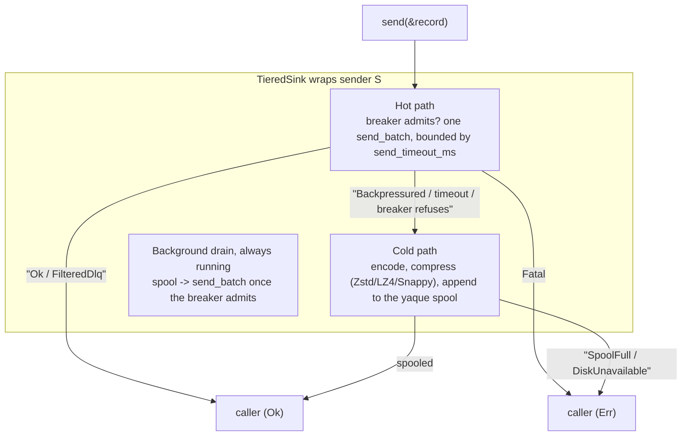
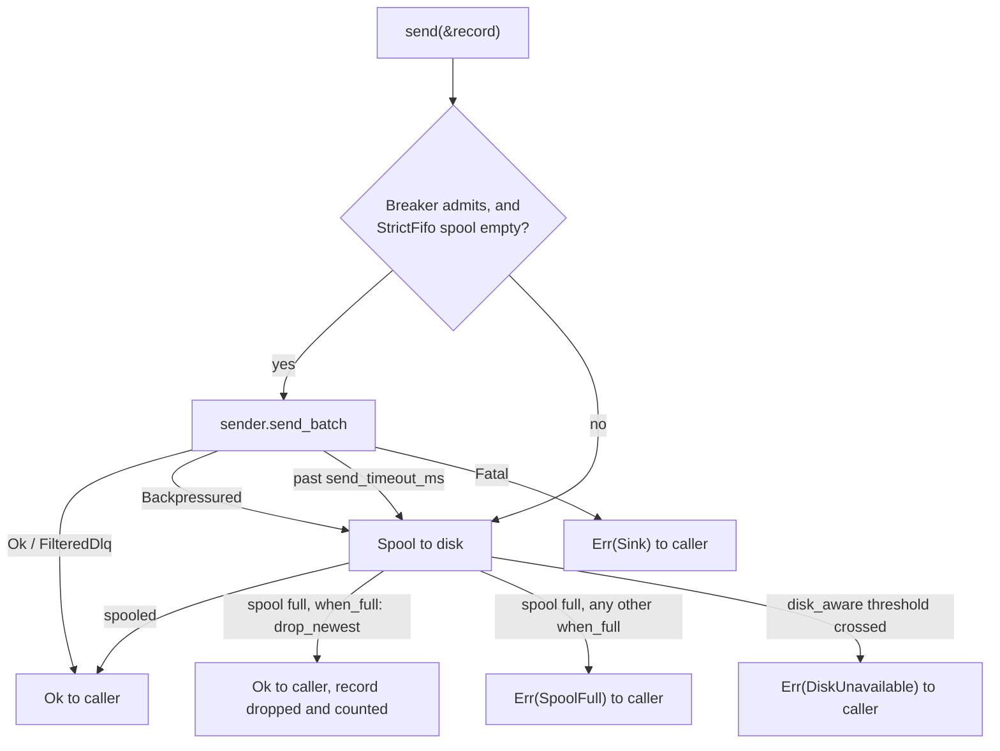
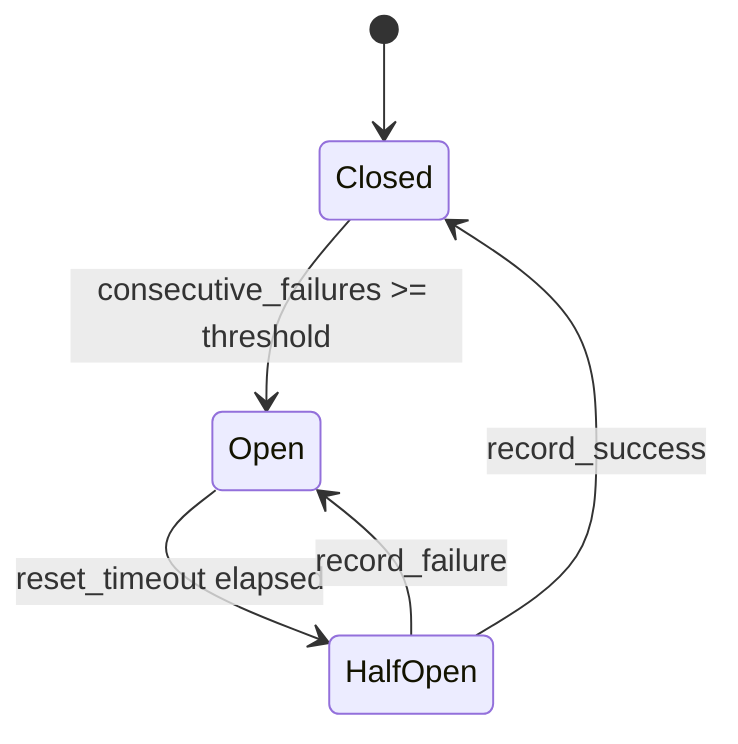

# Tiered Sink

`TieredSink<S>` wraps any `TransportSender` (Kafka, gRPC, HTTP, file, pipe, or the factory's `AnySender`) with the resilience primitives every production data-plane pipeline needs -- timeout, circuit breaker, disk spillover, background drain. Apps call `sink.send(&record).await?` and the sink picks the right failure response.

This is the canonical "resilient delivery" primitive. Every downstream
write in the data plane should sit behind one.

---

## What it composes



A `disk_capacity_poller` watches the spool filesystem when
`disk_aware` is configured -- if usage crosses the threshold the
`disk_available` flag flips and new spool writes return
`DiskUnavailable` instead of silently filling the disk.

---

## Failure modes



| `send_batch` result | Disposition | Circuit effect |
| ------------- | ------------- | ---------------- |
| `Ok` / `FilteredDlq` | `Ok` to the caller | Success recorded: failure count reset, circuit closes |
| `Backpressured` | Spool to disk | Failure recorded and counted in `spool_circuit_trips_total`, may open the circuit |
| `Fatal(e)` | `Err(TieredSinkError::Sink)` to the caller | None. Not spooled |
| No answer within `send_timeout_ms` | Spool to disk | Failure recorded and counted in `spool_circuit_trips_total`, may open the circuit |

The sink reads the `SendResult` every `TransportSender` already returns, so any sender plugs in unchanged. `FilteredDlq` counts as delivered and `send` returns `Ok`, so a record the sender filtered for the DLQ is not handed back to the caller. A spooled record the drain later gets `Fatal` for is dropped and logged, unless the error is `TransportError::Config` or `Closed`. Those describe the sink and not the record (a Kafka sink whose credentials are refused, say), so the record stays spooled and the circuit counts a failure until the sink is fixed.

---

## Circuit breaker

Three states, evaluated per `send` and per drain pass:



- **Closed** -- hot path active, failures counted.
- **Open** -- hot path skipped, every message goes straight to spool.
- **Half-open** -- one probe allowed, taken by whichever of a `send` or the drain asks first. Success -> Closed, failure -> Open. A probe that records neither, because its future was dropped or its outcome counts as neither, is lost once `reset_timeout` has passed since it went out, and the next caller probes again.

Hooks into the global `HealthRegistry` (when `health` feature is on)
so `/readyz` reports the sink as Degraded (HalfOpen) or Unhealthy
(Open).

See [`../../src/tiered_sink/circuit.rs`](../../src/tiered_sink/circuit.rs).

---

## Ordering modes

| Mode | Hot path policy | Trade-off |
| ------ | ----------------- | ----------- |
| `Interleaved` (default) | Always try hot path when circuit allows | Max throughput; new messages may arrive before older spooled ones |
| `StrictFifo` | Hot path only when spool is empty | Strict order; new traffic queues behind drain |

`StrictFifo` is what you pick when downstream ordering matters
(transaction log replication, append-only stores). Most pipelines
accept the interleave for the throughput win.

---

## Drain strategies

The background drain (`drainer::drain_loop`) pulls from the spool and
re-tries the primary sink at a rate controlled by `DrainStrategy`:

| Strategy | Behaviour |
| ---------- | ----------- |
| `Adaptive { initial_rate, max_rate }` (default) | Start slow (100 msg/s), accelerate based on success rate, cap at `max_rate` (10 000 msg/s) |
| `RateLimited { msgs_per_sec }` | Fixed rate |
| `Greedy` | Drain as fast as possible -- risks overwhelming a recovering sink |

A pass that takes a record off the spool starts the next at once, so the strategy sets the rate. `drain_interval_ms` (100 ms) is the wait after a pass that found the spool empty or the sink down.

The drain task is `tokio::spawn`'d at construction. It and the disk poller both stop when the sink's shutdown `CancellationToken` is cancelled, by `shutdown()` or by drop. With the `shutdown` feature the drain task also stops on the global token.

Each drain send is bounded by `send_timeout_ms`, the limit the hot path uses. A send that runs past it counts as a circuit failure. The record stays at the head of the spool, uncommitted, and is offered again on the next drain pass. The downstream may have taken the record before the timeout, so the retry can duplicate it (at-least-once).

---

## Spool sizing and disk awareness

- `max_spool_items` -- record limit for the spool.
- `max_spool_bytes` -- byte limit, as stored (post-compression).
- `disk_aware: { max_usage_percent, poll_interval_secs }` -- background
  `statvfs` poller; once filesystem use crosses the threshold,
  `disk_available` flips false and spool writes return
  `DiskUnavailable`.

On a Kubernetes emptyDir `statvfs` reads the node's disk, not the volume's `sizeLimit`, so a spool past the limit gets the pod evicted and the spool lost. The scalo-service chart sets `SCALO_WRITABLE_PATH_LIMITS` to each emptyDir writable path with a `sizeLimit`. With `max_spool_bytes` unset, `TieredSink::new` caps a spool on such a path at nine tenths of its limit. On Kubernetes, `disk_aware` with no cap at all is refused with `SpoolOpen`.

A spill past `max_spool_items` or `max_spool_bytes` applies `when_full`:

| `when_full` | `send` returns |
| --- | --- |
| `block` (default) | `Err(TieredSinkError::SpoolFull)` |
| `drop_newest` | `Ok`. The record is dropped and counted in `tiered_sink_dropped_total{policy="drop_newest"}` |
| `dlq`, `drop_oldest` | Not wired yet: behaves as `block`, with a warning logged on each spool-full event |

Crossing the `disk_aware` threshold returns `Err(TieredSinkError::DiskUnavailable)` whatever `when_full` says. The caller decides what to do with either error -- the typical pattern is to route the record to the DLQ.

`TieredSink::new` clears spool locks a killed process left behind and refuses a `spool_path` another live sink holds, so each sink needs its own path. A spill cache that will not open is quarantined into a `corrupt-*` subdirectory of `spool_path`, never by renaming the path. See [spool.md](spool.md#locks-after-a-hard-kill).

---

## Configuration

```yaml
tiered_sink:
  spool_path: /var/spool/myapp/clickhouse
  send_timeout_ms: 1000
  compression: { zstd: { level: 1 } }   # or none, lz4, snappy
  drain_strategy:
    type: adaptive
    initial_rate: 100
    max_rate: 10000
  ordering: interleaved
  max_spool_items: 1000000
  max_spool_bytes: 10737418240   # 10 GiB
  when_full: block
  crc: false
  on_corruption: quarantine
  circuit_failure_threshold: 5
  circuit_reset_timeout_ms: 30000
  drain_interval_ms: 100
  disk_aware:
    max_usage_percent: 0.8
    poll_interval_secs: 5
```

A `circuit_reset_timeout_ms` below `send_timeout_ms` logs a WARN naming both when the sink starts. A half-open probe still sending is then lost before its send can time out, so a second probe can join it.

`TieredSinkConfig::new(path)` plus the builder methods cover the
common cases without writing the full struct.

---

## Metrics

Emitted through the `metrics` crate, and only when scalo is built with the `metrics` feature (`metrics-core` alone does not emit them). Names are bare. A `metrics.namespace` prefixes each with `{namespace}_`, see [../core-pillars/metrics.md](../core-pillars/metrics.md). `ServiceMetrics::register` describes every one of them in `/metrics/manifest`.

| Metric | Type | Labels | What it reports |
| --- | --- | --- | --- |
| `spool_hot_path_total` | counter | none | Records the sink took directly, answering `Ok` or `FilteredDlq` within `send_timeout_ms` |
| `spool_cold_path_total` | counter | none | `send` calls that ended on the spool path without error. Includes records shed by `drop_newest`, since `send` returns `Ok` for them |
| `spool_circuit_trips_total` | counter | none | Hot-path sends that failed against the breaker (`Backpressured`, or past `send_timeout_ms`). One per failed send, not per Closed-to-Open change. Drain failures are not counted |
| `spool_circuit_state` | gauge | none | Breaker state at the last `send`: `0` closed, `1` half-open, `2` open. Half-open shows once the reset timeout has passed, before a probe goes out. An idle sink keeps its last value |
| `tiered_sink_overflow_total` | counter | `policy` | Records shed because the spool was full. Only `drop_newest` emits it. `block` returns `SpoolFull`, and `dlq` and `drop_oldest` fall back to `block`, so none of them count |
| `tiered_sink_dropped_total` | counter | `policy` | Records dropped on overflow. Moves with `tiered_sink_overflow_total` |
| `spool_messages` | gauge | none | Records in the spool after the last spill. The drainer never updates it, so it goes stale once draining starts. `spool_len()` is the live count. `ServiceMetrics::spool_messages` writes the same series |
| `spool_bytes` | gauge | none | Bytes in the spool as stored (compressed, plus the CRC header when `crc` is on). Stale the same way. `spool_bytes()` is the live figure. `ServiceMetrics::spool_bytes` writes the same series |
| `spool_disk_available_bytes` | gauge | none | Bytes free to unprivileged users on the spool's filesystem, set every `poll_interval_secs` by the disk poller, so only with `disk_aware` |
| `spool_disk_total_bytes` | gauge | none | Size of that filesystem, set with `spool_disk_available_bytes` |
| `spool_dropped_without_shutdown_total` | counter | none | Sinks dropped with records still spooled and no completed `shutdown().await`. Flat after a clean `shutdown()` |
| `spool_stale_locks_cleared_total` | counter | `lock`, `reason` | Lock files left by a dead process, removed on `TieredSink::new`. `lock` is `send`, `recv` or `version`, `reason` is `dead_owner` or `unparseable`. Non-zero means a previous run ended without releasing its locks. See [spool.md](spool.md#locks-after-a-hard-kill) |
| `spool_quarantined_total` | counter | `trigger` | A spill cache that would not open, moved into `corrupt-*` under `spool_path`. The tiered sink emits only `trigger="open_failed"`. See [spool.md](spool.md#quarantine) |

Alert on:

- `spool_dropped_without_shutdown_total` above 0. A sink was dropped with records still spooled and no completed `shutdown().await`, so fix the caller. Spooled records stay on disk and replay on the next open, but `Drop` does not wait for a drain in flight.
- `tiered_sink_dropped_total` rising. `drop_newest` is discarding records.
- `spool_circuit_state` held at `2`. The sink is down and everything is going to the spool.
- `1 - spool_disk_available_bytes / spool_disk_total_bytes` nearing `max_usage_percent`. Spool writes then return `DiskUnavailable`.
- `spool_quarantined_total` above 0. A spill cache was set aside and its records are not replayed.

No metric counts a `SpoolFull` or `DiskUnavailable` error, which goes back to the caller, or a record the drainer discards (a CRC, decompression or decode failure, or a `Fatal` answer about the record itself), which is logged at error level.

---

## API surface

| Item | Purpose |
| ------ | --------- |
| `TieredSink::new(sender, config)` | Construct, open spool, spawn drain task. `S` is any `TransportSender`; the sink calls its `send_batch` with one record and acts on the `SendResult` |
| `send(&Record) -> Result<()>` | Hot path, else spool. Errors go back to the caller, which routes the record (usually to the DLQ) |
| `spool_len() / spool_is_empty() / spool_bytes()` | Spool depth introspection |
| `circuit_state()` | Current `CircuitState` |
| `reset_circuit()` | Manual reset (admin / test) |
| `hot_path_count() / cold_path_count()` | Cumulative path counters |
| `is_disk_available()` | Disk-aware poller flag |
| `inner() -> &S` | Borrow the wrapped backend |
| `shutdown()` | Stop the drain task and the disk poller, and wait for both to exit |
| `TieredSinkError` | `SpoolOpen` from `new`. From `send`: `Sink` (a `Fatal` answer), `SpoolFull`, `DiskUnavailable`, `Spool` (the spool write failed), `Codec` (compression failed) |
| `TieredSinkConfig` / `WhenFull` / `OrderingMode` / `DrainStrategy` / `DiskAwareConfig` / `CompressionCodec` / `CorruptionPolicy` | Configuration, see [Configuration](#configuration) |
| `CircuitBreaker` / `CircuitState` | Exposed for tests and custom integrations |

`shutdown()` lets a drain already in flight finish its send and commit, then returns. A drain send to a downstream that never answers is cut off at `send_timeout_ms`, so `shutdown()` waits at most that long. It does not drain the spill cache to the sink: records still spooled stay on disk and replay on the next open, so shutdown loses nothing `send` accepted.

Drop cancels the same token, so both background tasks exit even if the consumer forgets to call `shutdown().await`, but drop cannot wait for them.

---

## Source

- [`../../src/tiered_sink/mod.rs`](../../src/tiered_sink/mod.rs)
- [`../../src/tiered_sink/tiered.rs`](../../src/tiered_sink/tiered.rs)
- [`../../src/tiered_sink/circuit.rs`](../../src/tiered_sink/circuit.rs)
- [`../../src/tiered_sink/error.rs`](../../src/tiered_sink/error.rs)
- [`../../src/tiered_sink/drainer.rs`](../../src/tiered_sink/drainer.rs)
- [`../../src/tiered_sink/codec.rs`](../../src/tiered_sink/codec.rs) -- compression
- [`../../src/tiered_sink/config.rs`](../../src/tiered_sink/config.rs)

---

## Related

- [spool.md](spool.md) -- the standalone yaque queue; this sink runs its own, with the same lock recovery and quarantine
- [dlq.md](dlq.md) -- where to send `SpoolFull` / `Fatal` errors
- [batch-engine.md](batch-engine.md) -- the run loops this is a common sink for
- [../transport/README.md](../transport/README.md)
- [../feature-flags.md](../feature-flags.md) -- `tiered-sink`
- [../auto-wiring.md](../auto-wiring.md)
- [../architecture.md](../architecture.md)
