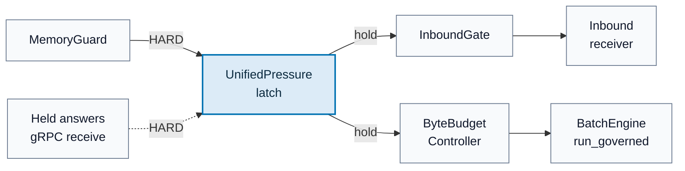

# Self-regulation

The data plane regulates itself. When a burst arrives, an upstream stalls,
or a transform balloons memory, a scalo app sized for steady state slows its
intake, lets the in-flight work drain, and speeds back up once the
pressure clears. This happens automatically, and an app wires nothing. The
limits are under "What the brake guarantees" below.

Self-regulation is **ON by default**. To turn it off (byte-identical to the
pre-governor data path), set one cascade key:

```yaml
self_regulation:
  enabled: false
```

When `enabled = false` the runtime constructs NOTHING -- no pressure
governor, no inbound gate, no byte-budget controller. Every `Option` stays
`None` and the data path is the original whole-batch loop. There is no
half-on state.

See [backpressure.md](backpressure.md) (where the brake is applied and
why) and [kafka-path.md](kafka-path.md) (how the Kafka GET/PROCESS/SEND
batch sizes feed the loop). The code lives in `src/governor/`.

---

## Self-regulation: the default vertical-scaling principle

Self-regulation is how a scalo app scales VERTICALLY: a pod sized for steady state slows down or speeds up its intake WITHIN the pod. HORIZONTAL scaling, where KEDA adds pods, runs independently from the triggers the deployment configures, and nothing makes it wait for the vertical headroom to run out.

Memory is the hard authority on the vertical side. By default it is the one source on the latch, a gRPC receive server built with a governor adds the bytes it holds unanswered, and the byte budget shrinks only while the latch holds. CPU is left to CFS: under a CPU quota the Linux scheduler throttles the process and each batch takes longer. There is no separate CPU brake: a pod short of CPU falls behind, and the lag that builds is the autoscaler's signal (see "Why memory is HARD and CPU is deliberately dropped" below).

The `self_regulation.enabled = false` opt-out leaves horizontal scaling via
`ScalingPressure` as it is.

| | Vertical (self-regulation) | Horizontal (KEDA) |
| --- | --- | --- |
| Question | "Should this pod pull more work right now?" | "Do we need more pods?" |
| Mechanism | MemoryGuard + UnifiedPressure inbound gate + AIMD byte budget | ScalingPressure -> external-scaler signal -> KEDA |
| Lives in | This library, in-pod | This library's signal, which KEDA acts on |
| Scope | One pod, its intake | The whole deployment, replica count |
| Timescale | Milliseconds | Seconds to minutes (pod start) |
| Cost | Free -- no new capacity | A new pod |
| Default | ON | Driven by the same pressure / lag signal |

The SAME pressure that brakes a pod's
intake surfaces as consumer lag (Kafka) or queue depth, which is the
signal `ScalingPressure` feeds to KEDA. Braking intake on one pod buys time
for the in-flight buffer to drain, and sustained pressure that the brake cannot
clear is exactly the condition that should add a replica. See the
`Pressure -> lag -> KEDA` section in [backpressure.md](backpressure.md) and
[pipeline/scaling.md](pipeline/scaling.md) for the KEDA signal.

---

## The three brains

Self-regulation is three distinct controllers with three distinct jobs.
They are NOT interchangeable, and each answers a different question.

| Brain | Question | Acts on | Source of truth? |
| --- | --- | --- | --- |
| **MemoryGuard** | "Are we about to OOM?" | The HARD pressure signal | YES -- the HARD signal |
| **ScalingPressure** | "Do we need more pods?" | KEDA / external scaler signal | Pool sizing, not the data path |
| **UnifiedPressure** | "Should I pull more work right now?" | The inbound gate + byte budget | Derived from the sources above |

- `MemoryGuard` (`src/memory/`) is the source of truth. Its
  `pressure_ratio()` is the process's memory usage, less inactive page cache,
  over an effective limit of `min(cgroup_headroom * memory.max, memory.high)`
  (`cgroup_headroom` 0.85), or `memory.limit_bytes` when set.
  [runtime/memory.md](runtime/memory.md) has how usage is read on each
  platform. The ratio feeds the governor as a **HARD** source: never
  weighted, never masked, so a saturated soft signal can never lower the
  combined level below what memory demands.
- `ScalingPressure` (`src/scaling/`) publishes a 0-100 score that a KEDA
  trigger the deployment adds can read. The scalo-service chart's default
  triggers read CPU and Kafka lag, not this score, and the score never pauses
  intake. See [pipeline/scaling.md](pipeline/scaling.md).
- `UnifiedPressure` (`src/governor/source.rs`) combines the sources into
  ONE normalised level in `[0.0, 1.0]` under a hysteretic latch. It is what
  the inbound gate and the byte-budget controller both consult. It samples every
  registered source and turns the readings into a single pause/resume
  decision.

## Why memory is HARD and CPU is deliberately dropped

Memory is the only resource that kills the process. Run out of CPU and the
work runs slower. Run out of memory and the kernel OOM-kills the pod
and in-flight data is lost. So memory is the HARD source -- the one signal
that always gets through.

CPU is deliberately NOT a pressure source:

- CFS self-corrects. Under a CPU quota the Linux scheduler throttles the process for us. A CPU-bound stage takes longer per batch. The byte budget does not react to that: a busy stage is not short of memory, and smaller blocks would only add per-call overhead.
- CPU saturation surfaces as lag, and lag is KEDA's job. A pod that
  cannot keep up grows consumer lag, and KEDA reads the lag and adds a replica.
  Horizontal scale is the right answer to "not enough CPU", not pausing
  intake on the one pod that is maxed.

`UnifiedPressure` can accept a CPU source LATER with **zero API change**.
`UnifiedPressure::add_source` takes any `PressureSource`, so a CPU
source would plug in as a SOFT, weighted source and every existing caller
of `level()` / `should_hold()` is untouched. The decision to drop CPU is a
default, not a wall.

## The memory signal: max, high, and PSI

The HARD memory source reads the container's cgroup, not host `used/total`
(on a shared node the host figure is unrelated to this pod's limit). Three
cgroup v2 inputs, container-first:

- `memory.max` -- the hard ceiling. Cross it and the kernel OOM-kills the
  pod. The guard's ratio is `(memory.current - inactive_file) / (0.85 * memory.max)`, so the
  default `pause_above` of 0.80 arms at 68% of `memory.max`.
- `memory.high` -- the soft throttle. The kernel reclaims hard and throttles
  allocations here, BEFORE the OOM-kill. When `memory.high` is below
  `0.85 * memory.max` it is the guard's limit, so the brake arms before the
  throttle's latency cliff, not just before the kill. The worker-pool scaler's
  `detect_memory_pressure()` takes the worst of `current/max` and
  `current/high`, without the headroom.
- `memory.pressure` (PSI `some avg10`) -- the earliest signal: the fraction
  of the last 10s in which a task stalled on memory. Emitted as the
  `worker_pool_memory_psi_some` gauge for observability/alerting. NOT folded
  into the shed decision -- the actionable stall-percent is workload-specific
  and wants per-service calibration, not a guessed constant.

---

## How the loop works

The HARD sources arm one latch, and the latch pauses the inbound source and shrinks the byte budget the batch engine sizes its sub-blocks by.



*Figure 1. L4 Detail -- Self-regulation loop. The held-answers source is attached only by a gRPC receive server built with a governor.* Up: [L3 Components -- scalo](README.md).

- The latch (`UnifiedPressure`, `src/governor/source.rs`) arms at
  `pause_above` and releases at `resume_below`. A hold is bounded in time:
  memory the process holds (allocator arenas, pages kept after a
  free) can keep the level above `resume_below` with nothing coming in, which
  would pause the source for good. After `max_hold_secs` (default 30) the
  latch admits one window, then re-arms if the level is still at
  `pause_above`. The window is one admission for a push source. For every `InboundGate` on the latch it is one resume that stays open until a receive returns records, or 2 s pass: a resumed Kafka consumer has to fetch before it returns anything, so the first receive after the resume is often empty. The byte budget never takes the window.
- `InboundGate` (`src/governor/gate.rs`) turns the latch into EDGE events:
  `pause()` once on the rising edge, `resume()` once on the falling edge. It
  pauses the inbound SOURCE (stops pulling new work) -- never the outbound
  drain. See [backpressure.md](backpressure.md) for why gating the drain
  deadlocks.

---

## The byte budget

`ByteBudgetController` (`src/governor/budget.rs`) is an AIMD (additive-increase / multiplicative-decrease) lever that sizes the inbound byte budget: the payload bytes one receive retains and one sub-block holds. The byte budget shrinks only while the latch holds: each held block shrinks it by `md_factor` toward its floor, and otherwise each block grows it by the profile's step toward the profile's ceiling. How busy a stage is, CPU saturation included, is the autoscaler's signal, not the budget's. Under a backlog a stage is about as busy at every block size, so a budget that shrank on busyness would fall to its floor and cap throughput at the sink's per-call cost. A release window's receives get the start budget, not the floor, until one returns records. See [kafka-path.md](kafka-path.md) for the PROCESS byte-budget's place among the three Kafka batch sizes.

The controller starts at `start_bytes`, large enough that a cold pipeline is not throttled. While the latch holds, each block shrinks the budget toward its floor, and once the latch opens each block adds the profile's step toward the ceiling, so recovery takes several blocks. A budget at or above the received block's bytes keeps the block as a SINGLE sub-block, as the whole-batch loop does.

The governed driver (`BatchEngine::run_governed`) is the run path a
self-regulating app calls. It dispatches on whether the byte budget is wired:
budget present -> stream in sub-blocks sized to the current budget and fold
each block into it.
Budget absent (governor off) -> delegate verbatim to `run_workbatch`,
byte-identical to pre-governor behaviour. The streaming sub-block mechanics
live in [backpressure.md](backpressure.md).

---

## Observe

| Signal | Kind | Meaning |
| --- | --- | --- |
| `self_regulation_inbound_paused` | gauge (0/1) | The inbound gate is holding (1) or open (0). Carries a `source` label (e.g. `kafka`, `http`) so two governed receivers on one pod are told apart |
| `self_regulation_inbound_pauses_total` | counter | Number of pause EDGES (rising transitions), not per-evaluate noise. Carries the same `source` label |
| `self_regulation_byte_budget` | gauge | Current AIMD byte budget (the inbound block-size lever), written by the controller at start and on every change |
| `self_regulation_recv_block_bytes` | gauge | Actual bytes of the most recent received block (reality, against which the budget is the intent) |
| `self_regulation_pressure_ratio` | gauge | Combined `UnifiedPressure.level()` in `[0, 1]`, written by the latch on any evaluation that moves it by 0.001 or more, paused or not |
| `self_regulation_max_hold_releases_total` | counter | Holds ended by `max_hold_secs` with the level still above `resume_below`, `signal` label = the source setting the level (`memory`, `ack_held`). A steady rate means memory the brake cannot free is holding the level up |
| `self_regulation_kafka_gate_errors_total` | counter | Kafka pause/resume actuator failures, `op` label = `pause` or `resume`. A sustained non-zero rate means the brake is silently disabled for the Kafka source -- alert on it |

With the `health` feature, each gate registers a
`self_regulation:<source>` health component that is `Unhealthy` while
the source is paused, so `/readyz` answers 503 while nothing is consumed.
Dropping the gate removes the component.

The gate fires each edge once (`ObservingActuator` in `src/governor/gate.rs`) and logs a brake-reason line on each:

```console
WARN  self-regulation: inbound PAUSED under pressure (memory/back-pressure brake)  source=kafka
INFO  self-regulation: inbound RESUMED  source=kafka
```

A hold that reaches `max_hold_secs` logs a WARN, at most once a minute,
`hold reached max_hold`, with the `pressure`, `resume_below`, `held_secs` and
the `signal` that set the level. Pause and resume pairs about `max_hold_secs`
apart, with that warning, mean the level is not falling to `resume_below` --
check the memory guard and consumer lag.

---

## Tune

All tuning is via the `self_regulation` cascade section (see
[core-pillars/config.md](core-pillars/config.md)). The runtime reads it once,
when it builds the governor, so a change takes a restart.

```yaml
self_regulation:
  enabled: true            # master switch (default true)
  profile: throughput      # throughput | balanced | low_latency -- sizes the AIMD envelope
  pause_above: 0.80        # arm the inbound hold when combined pressure reaches this
  resume_below: 0.65       # release the hold when pressure drops to this (must be < pause_above)
  max_hold_secs: 30        # longest one hold lasts above resume_below; 0 = no bound
  md_factor: 0.5           # byte-budget decrease per held block, in (0, 1)
```

| Key | What it does |
| --- | --- |
| `enabled` | The only knob most apps touch. `false` builds nothing |
| `profile` | Sizes the AIMD byte-budget envelope (start / ceiling / step / record cap). `throughput` starts big with a high ceiling, and `low_latency` starts small so blocks stay small and bursty. It mirrors the Kafka `SelfRegulationProfile` names so one value reads the same regardless of transport |
| `pause_above` / `resume_below` | The hysteresis band. The gap between them prevents flapping: the latch arms at `pause_above`, releases at `resume_below`, and holds its state in between. An inverted or non-finite band falls back to the defaults (`0.80` / `0.65`) with a warning rather than leaving the latch unable to release |
| `max_hold_secs` | The bound on one hold (see "How the loop works"). `0` restores the unbounded latch, which holds until the level falls to `resume_below` however long that takes |
| `md_factor` | How hard to brake while the latch holds. `0.5` halves the budget per block |
| `target_rho` | Has no effect: the byte budget shrinks only while the latch holds. The key is still accepted, so a config that sets it loads unchanged |

Every default is set so an app that configures nothing gets a fully working,
default-ON governor. Bad knobs are sanitised, not fatal.

The default `throughput` profile starts the byte budget at 16 MiB, and a small or memory-tight pod takes its first block at that size before the latch has seen any pressure. Pressure shrinks the budget for the blocks after it but cannot bound memory a block has taken. There is no small-pod preset and no key for the start budget: pick `balanced` (8 MiB start) or `low_latency` (1 MiB start) instead.

### What the brake guarantees

The brake stops NEW intake once the level reaches `pause_above` and shrinks
the blocks after it. It does not bound memory admitted before the pause, and it cannot
stop an allocation under way: the usage reading can be 50 ms old, and one
block can be larger than the headroom left above the pause point. On a pod
limited to 256-512 MiB a burst can OOM-kill the process within about a
second with the brake on. So it is load shedding, not an OOM
guarantee: leave headroom above the pause point for the largest block the
pod takes.

`tests/operational_memory.rs` checks that against a kernel OOM-killer: it runs `examples/mem_loadgen.rs` in a container under a `--memory` limit and asserts the process survives with the guard's `try_reserve` on and is OOM-killed with it off. It needs Docker, is `#[ignore]` by default, runs in the full test tier, and `scripts/operational-mem-test.sh <limit> <secs>` runs it by hand.
